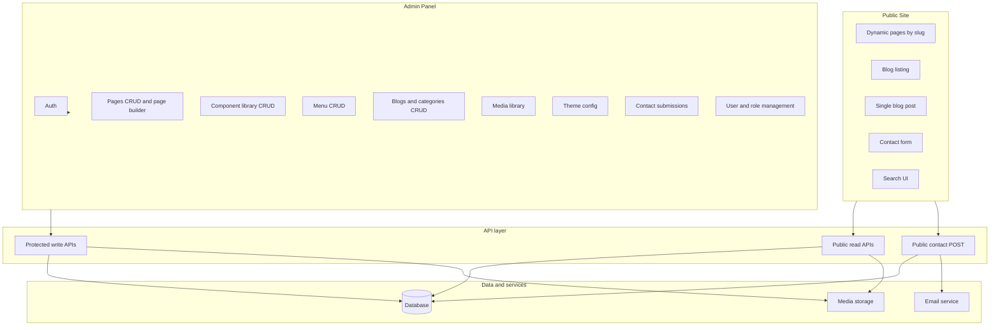

# Next.js Custom CMS — Robust Feature Plan (New Build)

## 1. Standard CMS analysis (WordPress, Wix, etc.)

Leading CMSs (WordPress, Wix, Squarespace, Webflow, Strapi) typically provide:

| Layer          | What they provide                                                                      |
| -------------- | -------------------------------------------------------------------------------------- |
| **Content**    | Pages, posts/blogs, media library, taxonomies (categories, tags), custom content types |
| **Structure**  | Menus/navigation, URL/slugs, sitemaps, redirects                                       |
| **Editing**    | WYSIWYG/rich text, block or page builders, component/template reuse, preview           |
| **Design**     | Themes, responsive layouts, global styles (colors, fonts), device preview              |
| **Engagement** | Forms (contact + email), comments, site search                                         |
| **Discovery**  | SEO (meta, canonicals, sitemaps, Open Graph, schema), analytics hooks                  |
| **Governance** | Users, roles, draft/publish, workflows, versioning                                     |
| **Operations** | Media optimization, backups, security, i18n                                           |

For a **new** custom CMS in Next.js, the plan below treats everything in this table as either **critical** (foundation) or **must-have** (full product). There is no "good-to-have" tier; all of the above are required for a robust CMS.

---

## 2. Tech stack (libraries)

| Layer        | Technology |
| ------------ | ---------- |
| Framework    | Next.js 14 |
| UI (admin)   | **Ant Design (antd)** 5.x + `@ant-design/icons` — component library for the admin panel (forms, tables, layout, modals, etc.). |
| Icons        | **Font Awesome** — icon library for use across admin and/or public site (e.g. `@fortawesome/fontawesome-free` or Pro). |
| UI (public)  | React; no component library required (custom or Tailwind/CSS). |
| Database     | MongoDB (Mongoose). |
| Auth         | NextAuth. |
| Other        | bcryptjs (passwords), slugify (URL slugs). |

---

## 3. Next.js built-in features (use in this project)

Next.js 14 provides these capabilities out of the box; use them instead of reinventing or adding extra libraries where possible.

**Routing and rendering**

- **App Router** — File-based routing under `app/`; `page.js` = route, `layout.js` = shared layout, `loading.js` = loading UI. Use for public CMS pages (`[slug]`), blog list/single, and admin.
- **Server Components** — Default in App Router; fetch data on the server, no client JS for static content; better SEO and smaller bundles. Use for public page/post rendering and layouts.
- **Client Components** — Add `'use client'` where you need state, events, or browser APIs (e.g. admin panel, forms, page builder). Your admin already uses this pattern.
- **Streaming** — Server Components stream HTML in chunks; use for faster first paint on content-heavy pages.

**Data and APIs**

- **Route Handlers** — `route.js` in `app/api/` for REST-style endpoints (GET, POST, etc.). Use for public read APIs (pages, blogs, menus, theme) and protected admin APIs; contact form POST can live here.
- **Server Actions** — Async functions with `'use server'`; call from forms or client code. Optional alternative to Route Handlers for mutations (e.g. contact submit, draft save) with progressive enhancement.
- **fetch and caching** — Server-side `fetch` is extended with caching; use for internal API calls or external services; disable cache when you need fresh CMS data (e.g. `cache: 'no-store'` or `revalidate`).

**SEO and metadata**

- **generateMetadata** — Async function in `layout.js` or `page.js` that returns `title`, `description`, `openGraph`, etc. Use with CMS meta (metaTitle, metaDescription) for pages and blog posts.
- **Static metadata** — Export `metadata` object for fixed values (e.g. root layout). You already use this in `layout.js`.
- **Sitemap** — Add `app/sitemap.js` (or `sitemap.xml`) and return an array of URLs (e.g. from published pages and blog slugs) with `lastModified`, `changeFrequency`, `priority`. Built-in and SEO-friendly.
- **Robots** — Add `app/robots.js` (or `robots.txt`) to control crawlers and point to the sitemap. Built-in.

**Images and media**

- **next/image** — `<Image>` with automatic optimization, responsive `sizes`, lazy loading, and optional blur placeholder. Use for CMS media (featured images, component images) on the public site.
- **generateImageMetadata** — Optional: generate multiple image metadata entries per route (e.g. for OG images or icons).

**Auth and security**

- **Middleware** — Runs before the request; use for protecting `/admin` and `/api/admin`, redirecting unauthenticated users, and allowing public routes. You already use this with NextAuth JWT.
- **next-auth** — Recommended in Next.js docs for auth; you use it for login and session; keep using it with the App Router.

**Other**

- **Link** — Use `<Link>` for in-app navigation (prefetching, client-side transition); avoid full reloads.
- **Redirects and rewrites** — Configure in `next.config.js` if you need legacy URL redirects or proxy rules.
- **Environment variables** — `process.env` and `.env` for secrets (MongoDB, NextAuth, email); use `NEXT_PUBLIC_*` only for values that must be exposed to the client.

**Summary:** Use App Router + Server Components for the public site; Route Handlers for APIs; `generateMetadata` and `app/sitemap.js` / `app/robots.js` for SEO; `next/image` for media; Middleware + NextAuth for admin protection. Server Actions are optional for forms.

---

## 4. Feature classification: critical vs must-have

### Critical (foundation — site does not function without these)

- **Content storage and retrieval** — Pages and blogs (or equivalent content types) with unique slugs, draft/published status, and stable APIs for read/write.
- **Public-facing rendering** — Visitors see pages and blog posts; dynamic routes resolve by slug; only published content is visible.
- **Authentication for admin** — Secure login; admin panel and write APIs are protected; session management (e.g. NextAuth or similar).

### Must-have (full product — expected in a robust CMS)

All of the following are required. Your seven explicit requirements are included and expanded with the rest.

**Content and structure**

- **Component library** — Reusable building blocks (layout, content, marketing, navigation) with a defined props schema and default values; admin CRUD; categories or grouping.
- **Custom page builder** — Compose pages from components; drag/reorder; per-instance props editing; layout persisted (e.g. array of component references + props + order).
- **Menu management** — One or more menus (e.g. header, footer); items with label, URL, order, optional "open in new tab"; admin CRUD; public API and front-end render (including responsive nav e.g. hamburger).
- **Blogs** — Posts with slug, rich content, excerpt, featured image, categories, author, tags, status; listing and single post pages; taxonomy (categories/tags) management.

**Editing and media**

- **Rich text / WYSIWYG** — For blog/post body and for any "richtext" field in components; structured or HTML output stored and safely rendered.
- **Draft vs published workflow** — Status on pages and posts; draft preview URLs (e.g. tokenised or role-gated) so editors can review before publish.
- **Media library and optimization** — Upload, store, and list assets; **image validation**: allowed formats **.png, .jpg, .jpeg, .webp, .gif**; max file size; max dimensions/resolution (reject or resize oversize uploads); responsive images (e.g. Next.js `Image` with sizes); lazy loading; optional cropping/focal point.

**Design and UX**

- **Theme editor** — Admin UI to edit global design: **typography** with **font sources**: (1) **import font families** (e.g. Google Fonts or similar — pick from catalog, load via link or npm), (2) **custom upload fonts** (upload .woff2/.woff/.ttf; store in media/fonts; register as font-family). Plus sizes for body/headings, line height, letter spacing, font weights; **font styling** (headings vs body, links, buttons); **colors** (primary, secondary, background, text); **layout** (max width, spacing scale); optional **header/footer** styles. Stored in theme config; applied on public site via CSS variables or theme provider. Single active theme with live or preview refresh.
- **Responsive website** — Layout and all components work on mobile, tablet, and desktop; breakpoints and touch-friendly navigation; theme or global layout width/fonts configurable.
- **RTL support** — Right-to-left layout for languages such as Arabic or Hebrew. Global or per-locale direction (LTR/RTL); set `dir="rtl"` on document or container; layout, menu, and components RTL-aware (e.g. logical CSS, flex/grid direction). Optional toggle in theme editor or derived from active locale.

**Engagement**

- **Contact forms with email** — Public form POST (unauthenticated); validation; store submissions in DB; send email to admin and/or auto-reply to submitter (via Resend, SendGrid, nodemailer, etc.); optional reCAPTCHA; admin list of submissions.

**SEO (full)**

- **SEO basics** — Per-page/post meta title and description; clean URLs (slugs); front-end sets `metadata` / `generateMetadata` from CMS data.
- **SEO advanced** — XML sitemap (pages + blog posts); `robots.txt`; canonical URLs; Open Graph (title, description, image); optional schema.org (e.g. Article, Organization) where relevant.

**Governance and operations**

- **Role-based access** — At least two roles (e.g. Admin vs Editor); Editors can create/edit content and use draft/preview; Admins can manage users, settings, and publish.
- **Search** — Site search (public) and/or admin search for content (pages, posts) by title/slug/content.
- **Multi-language (i18n)** — Locale-aware content (pages, menus, blogs) or at least a clear content model and URL strategy (e.g. `/en/about`, `/ar/about`) and locale switcher; stored translations or fallbacks. **RTL support** per locale where needed (direction, RTL-aware layout and components).
- **Analytics and backups** — Ability to plug in analytics (e.g. script or server-side events); documented backup/restore for DB and media (or integration with managed backup).

---

## 5. Your seven requirements inside the must-have list

| Your requirement         | Where it sits in the plan             |
| ------------------------ | ------------------------------------- |
| Component library        | Must-have — Content and structure     |
| Custom page builder      | Must-have — Content and structure     |
| Menu management          | Must-have — Content and structure     |
| Blogs                    | Must-have — Content and structure     |
| SEO                      | Must-have — SEO basics + SEO advanced |
| Responsive website       | Must-have — Design and UX             |
| Contact forms with email | Must-have — Engagement                |

All seven are mandatory and are covered by the critical + must-have sections above.

---

## 6. Target architecture (new CMS)

- **Public site:** Next.js app router; dynamic `[slug]` for CMS pages; `/blog`, `/blog/[slug]` for posts; contact form and search UI.
- **Admin:** Protected routes; CRUD for pages (with page builder), components, menus, blogs, media, theme, contacts, users/roles.
- **APIs:** Public GET for published pages, blogs, categories, menus, theme; protected GET/POST/PUT/DELETE for admin; public POST for contact only.
- **Data:** Database for content and config; email provider for contact; file storage for media.

---

## 7. Recommended implementation phases (new build)

Build order is designed so each phase delivers a usable slice and the next phase does not block on optional tech choices.

### Phase 1 — Foundation (critical)

- **Auth** — Login, session, protected admin layout and API guards.
- **Content model and APIs** — Pages (title, slug, status, layout array, meta fields), Blogs + Categories (slug, content, status, meta, author, taxonomy); protected CRUD APIs.
- **Public read APIs** — Unauthenticated GET for published page by slug, published blogs (list + by slug), categories, and later theme/menus.
- **Public rendering** — Dynamic page route (resolve by slug, 404 if draft/missing); blog list and single post routes; component renderer that maps layout + props to React components.
- **Metadata** — `generateMetadata` from CMS meta title/description for pages and posts.

### Phase 2 — Component library and page builder (must-have)

- **Component model** — Name, displayName, type (system/custom), category, baseComponent, propsSchema, defaultProps, active flag.
- **Admin component CRUD** — Create/edit component definitions and props schema.
- **Page builder UI** — Add/remove/reorder components on a page; edit per-instance props (drawer or inline); save layout to page document.
- **Component renderer** — Map `baseComponent` + props to actual React components; handle missing component gracefully.

### Phase 3 — Menus, theme editor, and responsive (must-have)

- **Menu model** — Name (e.g. header, footer), items (label, url, order, openInNewTab).
- **Menu admin and public API** — CRUD in admin; GET in public API; render in layout (header/footer).
- **Theme editor** — Admin UI for global design: **typography** with **font sources**: (1) **Google Fonts (or similar)** — select from catalog, load via link or package; (2) **custom upload fonts** — upload .woff2/.woff/.ttf, store in media/fonts, register as font-family. Plus base/heading sizes, line height, letter spacing, weights; **font styling** (body, headings, links, buttons); **colors**; **layout**. Persist in theme/site config; public API; apply via CSS variables or theme provider. Optional: light/dark mode, header/footer overrides, **global direction (LTR/RTL)** for RTL support.
- **Responsive** — Breakpoints, responsive nav (e.g. hamburger), responsive components and images.

### Phase 4 — Contact forms and email (must-have)

- **Contact submission model** — Form id, payload (e.g. name, email, message), page/source, isRead.
- **Public POST API** — Validate, save, trigger email (to admin and/or submitter).
- **Email integration** — Resend, SendGrid, or nodemailer; env-based config.
- **Contact form component** — Public form component that POSTs to API; optional reCAPTCHA.
- **Admin** — List submissions, mark read, delete.

### Phase 5 — SEO advanced, media, rich text (must-have)

- **SEO** — Sitemap (pages + blog slugs), robots.txt; canonical; Open Graph (title, description, image); optional schema.org where useful.
- **Media library** — Upload with **validation**: allowed types **.png, .jpg, .jpeg, .webp, .gif**; max file size (e.g. 5MB); max width/height or resolution (reject or auto-resize); store (DB + file storage), list in admin; link from pages/blogs/components; responsive images (Next/Image, sizes) and lazy load.
- **Rich text / WYSIWYG** — Editor for blog body and for richtext fields in components; safe render (sanitised HTML or structured blocks).

### Phase 6 — Draft preview, roles, search, i18n (must-have)

- **Draft preview** — Preview URLs for pages/posts (e.g. token or role-gated) so editors can view before publish.
- **Role-based access** — Roles (e.g. Admin, Editor); permission checks in admin and APIs (e.g. only Admin manages users and theme).
- **Search** — Public site search (e.g. by title/slug/excerpt); and/or admin search for pages and posts.
- **Multi-language** — Content model and APIs support locale; locale in URL or cookie; admin UI to manage translations; locale switcher on front-end; **RTL support** (dir per locale, RTL-aware layout and components); optional backup/export of content.

### Phase 7 — Analytics and backups (must-have)

- **Analytics** — Documented way to add script or server-side events (e.g. GA, Plausible); or simple events table for internal analytics.
- **Backups** — Documented backup/restore for database and media (e.g. cron + export, or use managed DB/media backup).

---

## 8. Senior review: gaps and suggested additions

**Review perspective:** What a senior developer would add or tighten after comparing the plan to WordPress and production CMS expectations.

### 8.1 WordPress-inspired features to consider adding

| WordPress feature | Suggestion for this CMS |
| ----------------- | ----------------------- |
| **Revisions / versioning** | **Content revisions** — Store revision history for pages and posts (e.g. last N versions or by date); compare diff and restore previous version. Improves safety and editorial workflow. Add under Governance or Phase 6. |
| **Scheduled publishing** | **Scheduled publish** — Allow “Publish at” date/time for pages and posts; a cron or job checks and flips status from draft to published at that time. Add to Draft vs published workflow. |
| **Comments** | **Comments on blog posts** (optional) — Moderation queue, approve/trash; store in DB; optional Disqus-like or native. Plan already lists “comments” in the standard CMS table; add as optional must-have under Engagement if you want blog discussion. |
| **Permalink structure** | **Configurable permalink base** (optional) — e.g. blog posts under `/blog/:slug` vs `/news/:slug`; single setting. You already have slugs; this is just a base path. |
| **Redirects** | **URL redirects (301)** — When a page slug is changed or a page is removed, support optional 301 redirects (from old URL to new). Admin: list of redirect rules (from → to). Add under Structure or Phase 5. |
| **Block/component types** | **Default component set (WordPress-like)** — Define an initial set of blocks so the page builder is usable out of the box. See 8.2 below. |
| **Import/export** | **Content export and import** — Export pages, posts, menus (e.g. JSON); import for backup, staging, or migration. Complements backups. Add to Phase 7 or Operations. |
| **Sticky posts** | **Pinned/sticky posts** — Optional “sticky” flag so a post stays at the top of the blog listing. Simple field + query. |
| **2FA / security** | **Optional two-factor auth (2FA)** for admin — TOTP (e.g. Google Authenticator) for sensitive sites. Add under Auth or Phase 6. |

### 8.2 Suggested default components (WordPress Gutenberg–inspired)

WordPress Gutenberg ships with many block types. Your component library can start with a small set so the page builder is immediately useful:

**Text:** Paragraph (richtext), Heading (level + style), List (bulleted/numbered), Quote, Code snippet.  
**Media:** Image (single), Gallery (multiple images), Video (embed or upload), File (download link), Cover (image/video with text overlay).  
**Layout:** Buttons (one or more CTAs), Spacer/Divider, Columns (e.g. 2/3 columns).  
**Content:** Call-to-action (heading + text + button), Embed (YouTube, Vimeo, etc. via URL).  
**Navigation:** Already covered by Menu management; optional “Breadcrumbs” component.

Add a short “Default components” subsection under Phase 2 or in the Component library must-have so implementers know what to build first.

### 8.3 Plan strengths (no change needed)

- Clear critical vs must-have; phasing is logical.
- Tech stack (Next.js, antd, MongoDB, NextAuth) is appropriate.
- Next.js built-in features are well called out (metadata, sitemap, image, middleware).
- Theme editor (fonts, RTL), image validation, and SEO are well specified.
- Architecture diagram and API split (public vs protected, contact POST) are correct.

### 8.4 Risks / things to watch

- **Component renderer** — Ensure the public site’s component map stays in sync with the admin component library (e.g. baseComponent name) and fails safely for unknown or removed components.
- **Public vs admin API paths** — Decide and document: either separate routes (e.g. `/api/public/pages`) or same route with optional auth and different response (e.g. only published for unauthenticated GET). Avoid mixing semantics.
- **Media storage** — Plan says “file storage”; for production, consider S3 or similar so uploads survive restarts and scale; document in Phase 7.
- **Rate limiting** — Add rate limiting on public contact POST and, if you add it, public search to avoid abuse.

---

## 9. Summary

- **Critical:** Auth, content model, public read APIs, and public rendering with metadata. Without these, the product is not a functioning CMS.
- **Must-have:** Everything else in Section 4: component library, page builder, menus, blogs, **theme editor (Google Fonts/catalog import, custom upload fonts, typography, font styling, colors, layout)**, full SEO (basic + advanced), responsive design, **RTL support**, contact forms + email, WYSIWYG, draft/preview, media optimization, roles, search, i18n, analytics and backups. There is no separate "good-to-have" tier; the plan is for a **robust** new CMS.
- **Your seven** — Component library, custom page builder, menu management, blogs, SEO, responsive website, and contact forms with email are all included as must-haves and are spread across Phases 1–5.
- **Phasing** — Phase 1 establishes the core; Phases 2–3 add builder and navigation; Phase 4 completes contact and email; Phases 5–7 add full SEO, media, rich text, preview, roles, search, i18n, and operations. The plan is implementation-agnostic and does not assume any existing codebase.

**Related docs:** Implementation tasks and phase checklist: **IMPLEMENTATION_PLAN.md**. Current gap vs codebase: **PROJECT_PLAN_GAPS.md**. Goals and backlog: **PROJECT_PLAN.md**.
