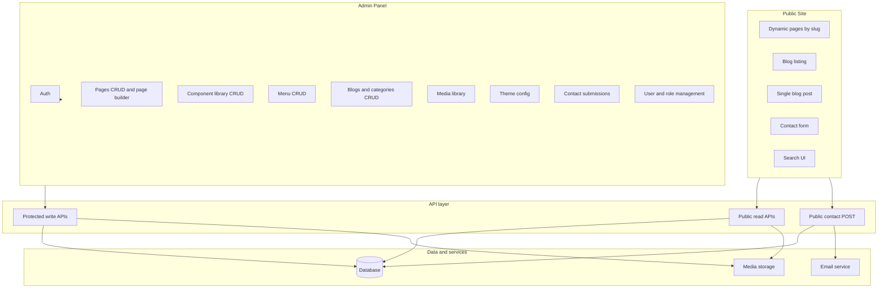

# Next.js Custom CMS — Robust Feature Plan (New Build)

## 1. Standard CMS analysis (WordPress, Wix, etc.)

Leading CMSs (WordPress, Wix, Squarespace, Webflow, Strapi) typically provide:

| Layer          | What they provide                                                                      |
| -------------- | -------------------------------------------------------------------------------------- |
| **Content**    | Pages, posts/blogs, media library, taxonomies (categories, tags), custom content types |
| **Structure**  | Menus/navigation, URL/slugs, sitemaps, redirects                                       |
| **Editing**    | WYSIWYG/rich text, block or page builders, component/template reuse, preview           |
| **Design**     | Themes, responsive layouts, global styles (colors, fonts), device preview              |
| **Engagement** | Forms (contact + email), comments, site search                                         |
| **Discovery**  | SEO (meta, canonicals, sitemaps, Open Graph, schema), analytics hooks                  |
| **Governance** | Users, roles, draft/publish, workflows, versioning                                     |
| **Operations** | Media optimization, backups, security, i18n                                           |

For a **new** custom CMS in Next.js, the plan below treats everything in this table as either **critical** (foundation) or **must-have** (full product). There is no "good-to-have" tier; all of the above are required for a robust CMS.

---

## 2. Tech stack (libraries)

| Layer        | Technology |
| ------------ | ---------- |
| Framework    | Next.js 14 |
| UI (admin)   | **Ant Design (antd)** 5.x + `@ant-design/icons` — component library for the admin panel (forms, tables, layout, modals, etc.). |
| Icons        | **Font Awesome** — icon library for use across admin and/or public site (e.g. `@fortawesome/fontawesome-free` or Pro). |
| UI (public)  | React; no component library required (custom or Tailwind/CSS). |
| Database     | MongoDB (Mongoose). |
| Auth         | NextAuth. |
| Other        | bcryptjs (passwords), slugify (URL slugs). |

**Required environment variables**

- **Critical (app must validate at startup):** `MONGODB_URI`, `NEXTAUTH_SECRET`, `NEXTAUTH_URL`. Missing values should cause a clear fail-fast at build/start (e.g. log and exit or throw in config).
- **Contact/email (Phase 4):** `EMAIL_FROM`, `EMAIL_TO`, and either `RESEND_API_KEY` (Resend) or SMTP vars (`SMTP_HOST`, etc.) for nodemailer.
- **Optional:** `NEXT_PUBLIC_SITE_URL` for sitemap, canonicals, and emails; reCAPTCHA keys if used.
- Document the full list in README; validate required env where the app boots so misconfiguration is obvious.

---

## 3. Next.js built-in features (use in this project)

Next.js 14 provides these capabilities out of the box; use them instead of reinventing or adding extra libraries where possible.

**Routing and rendering**

- **App Router** — File-based routing under `app/`; `page.js` = route, `layout.js` = shared layout, `loading.js` = loading UI. Use for public CMS pages (`[slug]`), blog list/single, and admin.
- **Server Components** — Default in App Router; fetch data on the server, no client JS for static content; better SEO and smaller bundles. Use for public page/post rendering and layouts.
- **Client Components** — Add `'use client'` where you need state, events, or browser APIs (e.g. admin panel, forms, page builder). Your admin already uses this pattern.
- **Streaming** — Server Components stream HTML in chunks; use for faster first paint on content-heavy pages.

**Data and APIs**

- **Route Handlers** — `route.js` in `app/api/` for REST-style endpoints (GET, POST, etc.). Use for public read APIs (pages, blogs, menus, theme) and protected admin APIs; contact form POST can live here.
- **Server Actions** — Async functions with `'use server'`; call from forms or client code. Optional alternative to Route Handlers for mutations (e.g. contact submit, draft save) with progressive enhancement.
- **fetch and caching** — Server-side `fetch` is extended with caching; use for internal API calls or external services; disable cache when you need fresh CMS data (e.g. `cache: 'no-store'` or `revalidate`).

**SEO and metadata**

- **generateMetadata** — Async function in `layout.js` or `page.js` that returns `title`, `description`, `openGraph`, etc. Use with CMS meta (metaTitle, metaDescription) for pages and blog posts.
- **Static metadata** — Export `metadata` object for fixed values (e.g. root layout). You already use this in `layout.js`.
- **Sitemap** — Add `app/sitemap.js` (or `sitemap.xml`) and return an array of URLs (e.g. from published pages and blog slugs) with `lastModified`, `changeFrequency`, `priority`. Built-in and SEO-friendly.
- **Robots** — Add `app/robots.js` (or `robots.txt`) to control crawlers and point to the sitemap. Built-in.

**Images and media**

- **next/image** — `<Image>` with automatic optimization, responsive `sizes`, lazy loading, and optional blur placeholder. Use for CMS media (featured images, component images) on the public site.
- **generateImageMetadata** — Optional: generate multiple image metadata entries per route (e.g. for OG images or icons).

**Auth and security**

- **Middleware** — Runs before the request; use for protecting `/admin` and `/api/admin`, redirecting unauthenticated users, and allowing public routes. You already use this with NextAuth JWT.
- **next-auth** — Recommended in Next.js docs for auth; you use it for login and session; keep using it with the App Router.

**Other**

- **Link** — Use `<Link>` for in-app navigation (prefetching, client-side transition); avoid full reloads.
- **Redirects and rewrites** — Configure in `next.config.js` if you need legacy URL redirects or proxy rules.
- **Environment variables** — `process.env` and `.env` for secrets (MongoDB, NextAuth, email); use `NEXT_PUBLIC_*` only for values that must be exposed to the client.

**Summary:** Use App Router + Server Components for the public site; Route Handlers for APIs; `generateMetadata` and `app/sitemap.js` / `app/robots.js` for SEO; `next/image` for media; Middleware + NextAuth for admin protection. Server Actions are optional for forms.

---

## 4. Feature classification: critical vs must-have

### Critical (foundation — site does not function without these)

- **Content storage and retrieval** — Pages and blogs (or equivalent content types) with unique slugs, draft/published status, and stable APIs for read/write.
- **Public-facing rendering** — Visitors see pages and blog posts; dynamic routes resolve by slug; only published content is visible.
- **Authentication for admin** — Secure login; admin panel and write APIs are protected; session management (e.g. NextAuth or similar).
- **Initial admin user** — After a fresh deploy, at least one admin user must exist. Create via **seed script** or **env-based bootstrap** (e.g. `ADMIN_EMAIL`, `ADMIN_PASSWORD`); document in README. Optional: seed default theme, one menu, one home page for first-run experience.
- **Database connectivity and health** — Document connection strategy (e.g. Mongoose cached connection for Node). Provide **`GET /api/health`** that checks DB connectivity and returns 200 or 503. Define behavior when DB is unavailable: public site shows a friendly error (e.g. 503 or static error page); admin shows a clear message; APIs return 5xx with a consistent shape.

### Must-have (full product — expected in a robust CMS)

All of the following are required. Your seven explicit requirements are included and expanded with the rest.

**Content and structure**

- **Slug rules** — **Uniqueness:** define scope (e.g. page slugs unique globally; blog slugs unique among posts). **Validation:** allowed characters (e.g. lowercase, hyphens) and max length; **reserved paths** (e.g. `admin`, `blog`, `contact`, `search`, `api`, `preview`) must not be used as page slugs — enforce in admin when saving and in API. On duplicate or invalid slug, API returns 400 with a clear message (and optional suggestion).
- **Component library** — Reusable building blocks (layout, content, marketing, navigation). **Props schema:** defined format with field types (e.g. text, richtext, image, url, number, select, boolean) and optional validation (required, maxLength); defaultProps must conform to propsSchema. Admin CRUD; categories or grouping. **Component map:** lives in application code; admin stores component definition (name, baseComponent, propsSchema, defaultProps) in DB; new block *types* require implementing the React component and registering it in the map (code deploy) — document this. **System vs custom:** define behaviour (e.g. system = built-in, not deletable; custom = admin-created definition, same code-backed map). **Deactivated/deleted:** when a component is deactivated or removed, renderer shows a defined fallback (e.g. “Unavailable block” placeholder); admin must show “X pages use this component” and require confirmation before deactivate/delete.
- **Custom page builder** — Compose pages from components; **layout structure:** array of blocks, each with a unique **instance id** (for keying and duplicate), component reference (componentId or baseComponent), **props** object, and **order** (explicit number or array index); document in API. **Flat layout** (top-level blocks only) unless nested blocks are explicitly supported (e.g. container with children); if nested, define max depth and data shape. Add/remove/**duplicate (clone)** block; drag/reorder (optional: keyboard-accessible reorder); per-instance props editing (drawer or inline); **validate** each block’s props against the component’s propsSchema on save — reject or sanitize invalid payloads with clear errors. **Public page API:** specify whether layout returns only componentId + props (renderer resolves baseComponent from in-app map) or also component metadata; document one approach. **Component versioning:** when schema changes, define whether layout stores a snapshot of props per block or validates against current schema; document migration or validation strategy for existing pages. Optional: component preview in admin (defaultProps); device/breakpoint preview in builder.
- **Menu management** — One or more menus (e.g. header, footer); items with label, URL, order, optional "open in new tab"; admin CRUD; public API and front-end render (including responsive nav e.g. hamburger).
- **Blogs management** — **Post model:** slug (unique among posts), title, content (rich text), excerpt, featuredImage (ref to media), author (ref to user or string), status (draft | published), publishedAt (optional), meta (metaTitle, metaDescription), tags (array of strings), category (ref to category or id); timestamps. **Taxonomy:** **Categories** — model with name, slug, optional description, order; **Tags** — can be inline on post (array) or separate Tag model. **Admin CRUD:** create/edit/delete posts (form: title, slug, content WYSIWYG, excerpt, featured image picker, category select, tags input, meta fields, status); list posts (table with filters: status, category, search by title/slug); categories CRUD (list, add, edit, delete, reorder). **APIs:** protected `GET/POST/PUT/DELETE /api/admin/blogs`, `GET/POST/PUT/DELETE /api/admin/blog-categories`; public `GET /api/public/blogs` (list published, paginate, filter by category, search), `GET /api/public/blogs/[slug]` (single published), `GET /api/public/blog-categories`. **Admin UI:** `/admin/blogs` (list + create/edit post), `/admin/blogs/categories` or nested (categories management). **Public:** listing page (`/blog`), single post (`/blog/[slug]`); metadata from post meta; sitemap includes blog slugs. Optional: sticky/pinned posts, author profile link.

**Editing and media**

- **Rich text / WYSIWYG** — For blog/post body and for any "richtext" field in components; structured or HTML output stored and safely rendered.
- **Draft vs published workflow** — Status on pages and posts; draft preview URLs (e.g. tokenised or role-gated) so editors can review before publish.
- **Media library and optimization** — Upload, store, and list assets; **image validation**: allowed formats **.png, .jpg, .jpeg, .webp, .gif**; max file size; max dimensions/resolution (reject or resize oversize uploads); responsive images (e.g. Next.js `Image` with sizes); lazy loading; optional cropping/focal point.

**Design and UX**

- **Error and loading UX** — Root and/or route-level **`error.js`** for public and admin so uncaught errors show a controlled UI. Use **`loading.js`** (or skeletons) for dynamic public routes (e.g. `[slug]`, blog) and key admin pages. Public site returns **404** for missing or draft content; a consistent **5xx** page for server errors.
- **Theme editor** — Admin UI to edit global design: **typography** with **font sources**: (1) **import font families** (e.g. Google Fonts or similar — pick from catalog, load via link or npm), (2) **custom upload fonts** (upload .woff2/.woff/.ttf; store in media/fonts; register as font-family). Plus sizes for body/headings, line height, letter spacing, font weights; **font styling** (headings vs body, links, buttons); **colors** (primary, secondary, background, text); **layout** (max width, spacing scale); optional **header/footer** styles. Stored in theme config; applied on public site via CSS variables or theme provider. Single active theme with live or preview refresh.
- **Responsive website** — Layout and all components work on mobile, tablet, and desktop; breakpoints and touch-friendly navigation; theme or global layout width/fonts configurable.
- **RTL support** — Right-to-left layout for languages such as Arabic or Hebrew. Global or per-locale direction (LTR/RTL); set `dir="rtl"` on document or container; layout, menu, and components RTL-aware (e.g. logical CSS, flex/grid direction). Optional toggle in theme editor or derived from active locale.

**Engagement**

- **Contact forms with email** — Public form POST (unauthenticated); validation; store submissions in DB; send email to admin and/or auto-reply to submitter (via Resend, SendGrid, nodemailer, etc.); optional reCAPTCHA; admin list of submissions.

**SEO (full)**

- **SEO basics** — Per-page/post meta title and description; clean URLs (slugs); front-end sets `metadata` / `generateMetadata` from CMS data.
- **SEO advanced** — XML sitemap (pages + blog posts); `robots.txt`; canonical URLs; Open Graph (title, description, image); optional schema.org (e.g. Article, Organization) where relevant.

**Governance and operations**

- **User management** — **Model:** users with at least `name`, `email`, `password` (hashed), `role` (reference to role or enum), `status` (e.g. active/inactive), optional `avatar` or `lastLoginAt`. **Admin CRUD:** create user (set email, name, role, initial password or send invite); edit user (name, email, role, status); delete or deactivate user; list users with filters (role, status) and search (name, email). **APIs:** protected `GET /api/admin/users` (list, paginate, filter), `GET /api/admin/users/[id]`, `POST /api/admin/users` (create), `PUT /api/admin/users/[id]` (update), `DELETE /api/admin/users/[id]` (or soft-delete via status). Only Admin can access user APIs. **Admin UI:** `/admin/users` — table of users, add/edit/delete, assign role, toggle status; prevent removing or demoting the last Admin. Optional: invite flow (email link to set password), bulk actions.
- **Role management** — **Fixed roles (minimum):** **Admin** and **Editor**. **Admin** can: access all admin routes; manage users (CRUD); manage theme/settings; publish and unpublish content; manage menus, media, components, pages, blogs, contacts; access draft preview. **Editor** can: create and edit pages, posts, and content; use draft and preview; manage own content; cannot access user management, theme, or (optionally) menus/settings. **Permission enforcement:** middleware or auth check on every admin route and admin API; reject with 403 if role insufficient. **Document:** in code or README, a clear matrix of “route/action → required role”. Optional (later): configurable roles — role CRUD and assign permissions per role; for initial release, fixed Admin/Editor in code is sufficient.
- **Rate limiting** — Apply to public endpoints that are abuse-prone: **contact form POST** (e.g. by IP or identifier); **public search** if implemented. Document or implement in Phase 4 (contact) and Phase 6 (search).
- **Security** — State-changing operations (contact POST, admin mutations) must be protected: same-origin only and/or CSRF tokens if cross-origin. Document or set **security headers** (e.g. Content-Security-Policy, X-Frame-Options, X-Content-Type-Options) where applicable (e.g. in middleware or server config). See Phase 7.
- **Password reset (optional)** — Forgot-password flow for admin (request reset, email with link, reset form, token validation) can be added in Phase 6 for production. If out of scope, state explicitly that admins are managed by seed/super-admin only.
- **Search** — Site search (public) and/or admin search for content (pages, posts) by title/slug/content.
- **Multi-language (i18n)** — Locale-aware content (pages, menus, blogs) or at least a clear content model and URL strategy (e.g. `/en/about`, `/ar/about`) and locale switcher; stored translations or fallbacks. **RTL support** per locale where needed (direction, RTL-aware layout and components).
- **Analytics and backups** — Ability to plug in analytics (e.g. script or server-side events); documented backup/restore for DB and media (or integration with managed backup).

---

## 5. Your seven requirements inside the must-have list

| Your requirement         | Where it sits in the plan             |
| ------------------------ | ------------------------------------- |
| Component library        | Must-have — Content and structure     |
| Custom page builder      | Must-have — Content and structure     |
| Menu management          | Must-have — Content and structure     |
| Blogs                    | Must-have — Content and structure     |
| SEO                      | Must-have — SEO basics + SEO advanced |
| Responsive website       | Must-have — Design and UX             |
| Contact forms with email | Must-have — Engagement                |

All seven are mandatory and are covered by the critical + must-have sections above.

---

## 5.1 Routing, folder structure, admin layout, and API middleware

- **Frontend routing and structure** — All public/frontend pages must follow a clear file and folder structure under the App Router, with the public site served at the **root path** (`/`). The base URL is the site root (e.g. `www.example.com`); home, dynamic pages by slug, blog, and other public routes live under `app/` with a consistent, logical structure (e.g. `app/page.js`, `app/[slug]/page.js`, `app/blog/...`).
- **Reserved paths** — The following paths must **not** be used as CMS page slugs; they are reserved for the application: **`admin`**, **`blog`**, **`contact`**, **`search`**, **`api`**, **`preview`** (and optionally `sitemap.xml`, `robots.txt`). Use **explicit routes** for these (e.g. `app/blog/...`, `app/contact/...`) so that a single `[slug]` dynamic route only handles non-reserved paths. Enforce reserved slugs in admin when saving (validation) and document in the API.
- **Admin routing and structure** — All admin pages must live under the **`/admin`** path (e.g. `www.example.com/admin`). File and folder structure under `app/admin/` must be organised so that admin routes (dashboard, pages, components, menus, blogs, media, theme, contacts, users, etc.) are in a proper hierarchy (e.g. `app/admin/layout.js`, `app/admin/page.js`, `app/admin/login/page.js`, `app/admin/pages/...`, `app/admin/settings/...`).
- **Admin login and layout** — A dedicated **`/admin/login`** page must exist for admin authentication. The admin layout must use **Ant Design (antd)** and include a **header** and **sidebar** (e.g. `Layout` with `Header` and `Sider`), with a **responsive** behaviour (e.g. collapsible sidebar, mobile-friendly menu) so the panel is usable on desktop, tablet, and mobile.
- **Middleware and API alignment** — **Middleware** must be used to protect admin routes and to align request handling. Public/frontend pages must fetch data from the **database** via defined APIs (Route Handlers or Server Actions). Middleware should ensure that frontend requests that need CMS data go through the correct API layer (e.g. public read APIs for published pages, menus, theme) so the frontend consistently gets data from the database through a single, clear API boundary. **Public read APIs:** document path convention (e.g. `/api/public/pages`, `/api/public/blogs`); optional version prefix (e.g. `/api/v1/public/...`) for future compatibility — if unversioned, document that breaking changes will be announced.

---

## 6. Target architecture (new CMS)

- **Public site:** Next.js app router; dynamic `[slug]` for CMS pages (non-reserved paths only); `/blog`, `/blog/[slug]` for posts; contact form and search UI.
- **Admin:** Protected routes; dashboard at `/admin` with summary and links; CRUD for pages (with page builder), components, menus, blogs, media, theme, contacts, users/roles.
- **APIs:** Public GET for published pages, blogs, categories, menus, theme; **`GET /api/health`** for DB health (200/503); protected GET/POST/PUT/DELETE for admin; public POST for contact only. Document path convention and optional versioning (e.g. `/api/v1/public/...`).
- **Data:** Database for content and config; email provider for contact; file storage for media.

---

## 7. Recommended implementation phases (new build)

Build order is designed so each phase delivers a usable slice and the next phase does not block on optional tech choices.

### Phase 1 — Foundation (critical)

- **Routing and folder structure** — Frontend at root `/` (e.g. `app/`, `app/[slug]/`, `app/blog/`); admin under `/admin`; clear file/folder hierarchy. **Reserved paths:** per Section 5.1 — enforce and document; use explicit routes so `[slug]` only handles non-reserved paths.
- **Initial admin user** — Seed script or env-based bootstrap (e.g. `ADMIN_EMAIL`, `ADMIN_PASSWORD`) to create first admin; document in README. Optional: seed default theme, one menu, one home page.
- **Database and health** — Document Mongoose connection strategy; add **`GET /api/health`** that checks DB and returns 200/503; define behavior when DB is down (friendly public error, clear admin message, consistent API 5xx).
- **Environment** — Validate required env at startup per Section 2; fail fast with clear message if missing.
- **Auth** — Login at `/admin/login`, session, protected admin layout and API guards.
- **Admin layout** — Per Section 5.1: Ant Design with header and sidebar; responsive (collapsible sidebar, mobile-friendly).
- **Admin dashboard** — `/admin` shows at least summary counts (pages, posts, contact submissions) and links to main sections; optional: recent activity.
- **Middleware** — Protect `/admin` routes; align APIs so frontend pages fetch CMS data from the database via public read APIs (middleware allows public routes and guards admin/API as needed).
- **Content model and APIs** — Pages (title, slug, status, layout array, meta fields); Blogs + Categories. **Slug rules:** per Section 4 (uniqueness, validation, reserved-path rejection; 400 on duplicate/invalid). Protected CRUD APIs for pages and blogs.
- **Blogs and categories (implementation)** — Implement per Section 4 (Blogs management): models, admin CRUD APIs and UI (`/admin/blogs`, `/admin/blogs/categories`), public APIs and pages (`app/blog/page.js`, `app/blog/[slug]/page.js`). Rich text for post body can be plain text in Phase 1; WYSIWYG in Phase 5.
- **Public read APIs** — Unauthenticated GET for published page by slug, published blogs (list + by slug), categories, and later theme/menus. Path convention and optional version prefix: per Section 5.1.
- **Public rendering** — Dynamic page route (resolve by slug, 404 if draft/missing); blog list and single post routes; component renderer that maps layout + props to React components.
- **Error and loading** — Root/route `error.js` for public and admin; `loading.js` or skeletons for dynamic public routes; 404 for missing/draft, consistent 5xx page.
- **Metadata** — `generateMetadata` from CMS meta title/description for pages and posts.

### Phase 2 — Component library and page builder (must-have)

- **Component model** — Name, displayName, type (system/custom), category, baseComponent, propsSchema, defaultProps, active flag. **System vs custom:** define (e.g. system = not deletable; custom = admin-created, same code-backed map).
- **Props schema format** — Field types (text, richtext, image, url, number, select, boolean) and optional validation (required, maxLength, etc.); defaultProps must conform; document schema format for API and admin.
- **Component map and deploy** — Map from baseComponent name to React component lives in code; admin defines component in DB (baseComponent, propsSchema, defaultProps). New block types require code deploy (new component + map entry). Document in README.
- **Default component set** — Ship with a minimal set so the builder is usable out of the box: e.g. Paragraph, Heading, Image, Buttons, Spacer, Columns (see Section 8.2); seed or register in DB and map.
- **Page layout data structure** — Layout = array of blocks; each block: unique instance id, componentId (or baseComponent), props, order. Document in page model and public page API. Decide flat-only or allow nested (e.g. Columns with children); if nested, define max depth and shape.
- **Public page API layout contract** — Specify whether GET page returns layout with only componentId + props (renderer resolves baseComponent in app) or also embeds component metadata; document one approach.
- **Admin component CRUD** — Create/edit component definitions and props schema. Before deactivate/delete: show count of pages using the component; require confirmation.
- **Page builder UI** — Add/remove/duplicate (clone) block; drag/reorder (optional: keyboard move up/down for accessibility); edit per-instance props (drawer or inline); save layout to page document. Optional: component preview with defaultProps; device/breakpoint preview (mobile/tablet/desktop).
- **Validation on save** — When saving a page, validate each block’s props against its component’s propsSchema; reject invalid payloads with clear errors (or sanitize where safe).
- **Component renderer** — Map baseComponent + props to actual React components. **Missing/deactivated component:** render defined fallback (e.g. “Unavailable block” placeholder). Handle schema changes: document whether layout stores snapshot of props or validates against current schema; optional migration path for existing pages.

### Phase 3 — Menus, theme editor, and responsive (must-have)

- **Menu model** — Name (e.g. header, footer), items (label, url, order, openInNewTab).
- **Menu admin and public API** — CRUD in admin; GET in public API; render in layout (header/footer).
- **Theme editor** — Implement per Section 4 (Theme editor): typography and font sources, colors, layout; persist in theme/site config; public API; apply via CSS variables or theme provider. Optional: light/dark mode, header/footer overrides, **global direction (LTR/RTL)** for RTL support.
- **Responsive** — Breakpoints, responsive nav (e.g. hamburger), responsive components and images.

### Phase 4 — Contact forms and email (must-have)

- **Contact submission model** — Form id, payload (e.g. name, email, message), page/source, isRead.
- **Public POST API** — Validate, save, trigger email (to admin and/or submitter). **Rate limit** `POST /api/contact` (e.g. by IP or identifier) to prevent abuse.
- **Email integration** — Resend, SendGrid, or nodemailer; env-based config.
- **Contact form component** — Public form component that POSTs to API; optional reCAPTCHA.
- **Admin** — List submissions, mark read, delete.

### Phase 5 — SEO advanced, media, rich text (must-have)

- **SEO** — Sitemap (pages + blog slugs), robots.txt; canonical; Open Graph (title, description, image); optional schema.org where useful.
- **Media library** — Upload with **validation**: allowed types **.png, .jpg, .jpeg, .webp, .gif**; max file size (e.g. 5MB); max width/height or resolution (reject or auto-resize); store (DB + file storage), list in admin; link from pages/blogs/components; responsive images (Next/Image, sizes) and lazy load.
- **Rich text / WYSIWYG** — Editor for blog body and for richtext fields in components; safe render (sanitised HTML or structured blocks).

### Phase 6 — Draft preview, roles, search, i18n (must-have)

- **Draft preview** — Preview URLs for pages/posts (e.g. token or role-gated) so editors can view before publish.
- **User management (implementation)** — Implement per Section 4 (User management). **Implementation:** User model and APIs under `/api/admin/users`; admin UI at `app/admin/users/page.js` (antd Table, add/edit/delete, role dropdown, last-Admin guard). Validate email uniqueness and strong password on create/update.
- **Role management (implementation)** — Implement per Section 4 (Role management). **Implementation:** roles in code; permission helper (e.g. `canAccessUsers(session)`, `canAccessTheme(session)`); enforce in middleware or per-route; protect `/admin/users`, `/admin/theme`, `/admin/settings` (and their APIs) → Admin only. Document matrix in README or `docs/PERMISSIONS.md`.
- **Search** — Public site search (e.g. by title/slug/excerpt); and/or admin search for pages and posts. **Rate limit** public search API to prevent abuse.
- **Password reset (optional)** — Forgot-password flow for admin (request reset, email link, reset form, token validation); or explicitly out of scope (admins managed by seed/super-admin only).
- **Multi-language** — Content model and APIs support locale; locale in URL or cookie; admin UI to manage translations; locale switcher on front-end; **RTL support** (dir per locale, RTL-aware layout and components); optional backup/export of content.

### Phase 7 — Analytics and backups (must-have)

- **Security** — Implement per Section 4 (Security): same-origin or CSRF protection; document or set security headers in middleware or server config.
- **Analytics** — Documented way to add script or server-side events (e.g. GA, Plausible); or simple events table for internal analytics.
- **Backups** — Documented backup/restore for database and media (e.g. cron + export, or use managed DB/media backup).

---

## 8. Senior review: gaps and suggested additions

**Review perspective:** What a senior developer would add or tighten after comparing the plan to WordPress and production CMS expectations.

### 8.1 WordPress-inspired features to consider adding

| WordPress feature | Suggestion for this CMS |
| ----------------- | ----------------------- |
| **Revisions / versioning** | **Content revisions** — Store revision history for pages and posts (e.g. last N versions or by date); compare diff and restore previous version. Improves safety and editorial workflow. Add under Governance or Phase 6. |
| **Scheduled publishing** | **Scheduled publish** — Allow “Publish at” date/time for pages and posts; a cron or job checks and flips status from draft to published at that time. Add to Draft vs published workflow. |
| **Comments** | **Comments on blog posts** (optional) — Moderation queue, approve/trash; store in DB; optional Disqus-like or native. Plan already lists “comments” in the standard CMS table; add as optional must-have under Engagement if you want blog discussion. |
| **Permalink structure** | **Configurable permalink base** (optional) — e.g. blog posts under `/blog/:slug` vs `/news/:slug`; single setting. You already have slugs; this is just a base path. |
| **Redirects** | **URL redirects (301)** — When a page slug is changed or a page is removed, support optional 301 redirects (from old URL to new). Admin: list of redirect rules (from → to). Add under Structure or Phase 5. |
| **Block/component types** | **Default component set (WordPress-like)** — Define an initial set of blocks so the page builder is usable out of the box. See 8.2 below. |
| **Import/export** | **Content export and import** — Export pages, posts, menus (e.g. JSON); import for backup, staging, or migration. Complements backups. Add to Phase 7 or Operations. |
| **Sticky posts** | **Pinned/sticky posts** — Optional “sticky” flag so a post stays at the top of the blog listing. Simple field + query. |
| **2FA / security** | **Optional two-factor auth (2FA)** for admin — TOTP (e.g. Google Authenticator) for sensitive sites. Add under Auth or Phase 6. |

### 8.2 Suggested default components (WordPress Gutenberg–inspired)

WordPress Gutenberg ships with many block types. Your component library can start with a small set so the page builder is immediately useful. **This is now a formal requirement in Phase 2 (default component set).**

**Text:** Paragraph (richtext), Heading (level + style), List (bulleted/numbered), Quote, Code snippet.  
**Media:** Image (single), Gallery (multiple images), Video (embed or upload), File (download link), Cover (image/video with text overlay).  
**Layout:** Buttons (one or more CTAs), Spacer/Divider, Columns (e.g. 2/3 columns).  
**Content:** Call-to-action (heading + text + button), Embed (YouTube, Vimeo, etc. via URL).  
**Navigation:** Already covered by Menu management; optional “Breadcrumbs” component.

Implementers should build at least Paragraph, Heading, Image, Buttons, Spacer, Columns in Phase 2; see Phase 2 and Section 4 (Component library, Custom page builder) for full requirements.

### 8.3 Plan strengths (no change needed)

- Clear critical vs must-have; phasing is logical.
- Tech stack (Next.js, antd, MongoDB, NextAuth) is appropriate.
- Next.js built-in features are well called out (metadata, sitemap, image, middleware).
- Theme editor (fonts, RTL), image validation, and SEO are well specified.
- Architecture diagram and API split (public vs protected, contact POST) are correct.

### 8.4 Risks / things to watch

- **Component renderer** — Ensure the public site’s component map stays in sync with the admin component library (e.g. baseComponent name) and fails safely for unknown or removed components. Plan now specifies: component map in code, deploy coupling, fallback for missing/deactivated components, and admin warning before deactivate/delete (Section 4, Phase 2).
- **Public vs admin API paths** — Decide and document: either separate routes (e.g. `/api/public/pages`) or same route with optional auth and different response (e.g. only published for unauthenticated GET). Avoid mixing semantics. Path convention and optional versioning are in Section 5.1 and Phase 1.
- **Media storage** — Plan says “file storage”; for production, consider S3 or similar so uploads survive restarts and scale; document in Phase 7.
- **Rate limiting** — Now in plan: Phase 4 (contact POST) and Phase 6 (public search). Implement and tune (e.g. by IP) to avoid abuse.

### 8.5 Component and page builder gaps (addressed)

The following gaps were identified and are now covered in **Section 4** (Component library, Custom page builder) and **Phase 2**; see those sections for detail:

Props schema format; page layout data structure (instance id, flat vs nested); component map source and deploy; component versioning / breaking changes; validation at save; default component set (see also 8.2); duplicate (clone) block; deactivated/deleted components (renderer fallback, admin warning); system vs custom; public API layout contract. Optional: component preview, device/breakpoint preview, keyboard-accessible reorder.

---

## 9. Summary

- **Critical:** Auth, **initial admin user (seed/bootstrap)**, **database connectivity and health endpoint**, content model, public read APIs, and public rendering with metadata. **Reserved paths** and **env validation** are part of the foundation. Without these, the product is not a functioning CMS.
- **Must-have:** Everything in Section 4 (slug rules, error/loading UX, component library, page builder, menus, blogs management, user management, role management, theme editor, SEO, responsive, RTL, contact forms, rate limiting, security, WYSIWYG, draft/preview, media, search, i18n, analytics and backups); admin dashboard; optional password reset. See Section 4 for full detail; Phases 1–7 for implementation order. Section 8.5 indexes component/page builder gaps now addressed. No separate "good-to-have" tier; the plan is for a **robust** new CMS.
- **Your seven** — Component library, custom page builder, menu management, blogs, SEO, responsive website, and contact forms with email are all included as must-haves and are spread across Phases 1–5.
- **Phasing** — Phase 1 establishes the core (routing, reserved paths, bootstrap, DB/health, env, error/loading, slug rules, dashboard, API convention); Phases 2–3 add builder and navigation; Phase 4 completes contact, email, and rate limiting; Phases 5–7 add full SEO, media, rich text, preview, roles, search, rate limit on search, optional password reset, i18n, security headers, and operations. The plan is implementation-agnostic and does not assume any existing codebase.

**Related docs:** Implementation tasks and phase checklist: **IMPLEMENTATION_PLAN.md**. Current gap vs codebase: **PROJECT_PLAN_GAPS.md**. Goals and backlog: **PROJECT_PLAN.md**.
