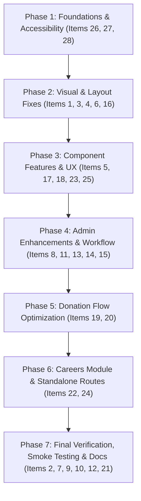

# Full Codebase Review & Implementation Plan — Admin Panel & Frontend

**Project:** MESCO Trust CMS  
**Date:** September 24, 2026  
**Environment Target:** Production & Demo (`mesco-demo.aiolos.cloud`)  
**Status:** Planning Only — No Source Code Changes Executed

---

## Project Review Summary

### 1. Overall Architecture
* **Framework:** Next.js 14 App Router (`app/` directory).
* **Runtime:** Node.js (v18+) with React 18 Server Components and Client Components.
* **Database & ORM:** MongoDB via Mongoose (`models/` with `connectDB()` in `lib/db.js`).
* **Authentication:** NextAuth.js (Credentials Provider with JWT sessions, bcryptjs password hashing).
* **Role-Based Access Control (RBAC):** Database-backed roles (`AdminRole`, `Permission`, `RolePermission`) with memory resolution, middleware gatekeeping, server layout auth redirects, and client context (`AdminAuthContext.js`).
* **Styling & Theming:** Ant Design 5 (`antd`), Bootstrap utility grids, styled-components with SSR registry (`StyledComponentsRegistry.js`), dynamic CSS variables mapped to MongoDB `ThemeConfig` via `styles/Theme.js`.
* **Animations:** GSAP 3 with `ScrollTrigger`, Lenis smooth scrolling (`components/cms/SmoothScroll.js`).
* **Media & Assets:** Local storage with `/public/uploads/`, crop/raster confirmation pipelines, sharp/canvas processing, and MongoDB `Media` document metadata.

---

### 2. Admin Architecture
* **Path:** `app/admin/...` (Login: `app/admin/login`, Authenticated: `app/admin/(authenticated)/`).
* **Layout:** `app/admin/(authenticated)/layout.js` enforces server-side session checks, role permission verification (`authorizeAdminPageAccess`), and passes permissions to `AdminLayoutClient.js`.
* **Navigation & Sidebar:** Dynamic Ant Design sidebar with grouped collapsible menus (`baseMenuItems` in `AdminLayoutClient.js`), checking `canAccessMenu(permissionKeys)` for each entry.
* **Component Platform:** 
  * Reusable Block & Site Component platform (`components/site/`).
  * Dedicated management routes for specialised components (`/admin/sliders`, `/admin/team`, `/admin/popups`, `/admin/appearance/*`, `/admin/form-builder`).
  * Generic component drawer editor (`/admin/components/[id]/edit`) backed by `/api/theme/[componentId]`.
* **Content Modules:** Pages (`/admin/pages`), Blogs (`/admin/blogs`), Categories, Comments, Media Library (`/admin/media`), Submissions (`/admin/submissions`), Subscribers, Donations, Events, Contacts, RBAC (`/admin/rbac/*`).

---

### 3. Frontend Architecture
* **Path:** `app/(site)/...`
* **Root Layout:** `app/(site)/layout.js` uses `x-pathname` from `middleware.js`, calls `getLayoutData(pathname)` to assemble theme tokens, active menus, site file settings, and appearance configurations.
* **Shell Rendering:** `components/layout/PublicShell.js` renders the `AppearanceHeaderRibbon`, `AppearanceHeader`, `RoutePopupHost`, `PublicPageReadySignal`, `ChatbotWidget`, and `AppearanceFooter`.
* **Dynamic Page Routing:** `app/(site)/[...slug]/page.js` queries `Page` model by slug, populates layout block components, fetches `Component.defaultProps`, merges props (`{ ...defaultProps, ...(block.props || {}) }`), and renders via `components/cms/ComponentRenderer.js`.
* **Home Page:** `app/(site)/page.js` renders the published page with slug `"home"`.

---

### 4. Backend/API Architecture
* **Conventions:**
  * Public APIs: `app/api/public/*`, `app/api/theme/*`, `app/api/payment/*`, `app/api/subscribe/*`, `app/api/contact/*`, `app/api/events/*`.
  * Admin APIs: `app/api/admin/*`, protected by `requireAuth(req)` in `lib/apiAuth.js` with permission and role assertions.
  * Theme API: `app/api/theme/[componentId]/route.js` handles GET (palette + defaults) and PUT (validations and updates to `Component` / `ThemeConfig`).

---

### 5. Database Architecture
* **Mongoose Models:** 41 active models in `models/`:
  * Core Content: `Page`, `Component`, `SiteComponentMeta`, `ThemeConfig`, `Appearance`, `Menu`, `Media`, `SiteFileSetting`.
  * Editorial & Community: `Blog`, `BlogCategory`, `BlogComment`, `Event`, `EventRegistration`, `SocialWallPost`.
  * Forms & Leads: `Form`, `FormSubmission`, `SubmissionFile`, `ContactSubmission`, `Subscriber`, `Donation`, `DonateNowSubmission`, `VolunteersFeedbackSubmission`.
  * Security & RBAC: `User`, `AdminRole`, `Permission`, `RolePermission`, `PermissionAuditLog`.

---

### 6. Shared Components & Existing Reusable Functionality
* `components/admin/media/MediaPickerInput.js` & `RasterCropConfirmModal.js`: Centralized media picker with modal preview, crop, aspect ratio, and URL persistence.
* `components/admin/SortableFormList.js`: Drag-and-drop / arrow reordering for array fields in Ant Design forms.
* `components/admin/TitleAndColorsSection.js`: Standardized title, subtitle, and color key selectors for site components.
* `components/admin/ManageSectionFields.js`: Unified section background (color/image), padding, margin, and container configuration.
* `components/site/HighlightedTitle.js` (`renderHighlightedTitle`): Universal asterisks markdown highlighter (`*accented text*`).
* `components/site/shared/PdfViewerModal.js`: Unified PDF document modal with Lenis scroll lock prevention.
* `lib/formValidation.js`: Common validators for email, Indian mobile, PAN, names, numeric inputs.

---

## Detailed Implementation Plan (Checklist Items 1 to 28)

---

### Item 1 — Media Upload: Aspect Ratio & Exact Dimensions Guidance

#### 1. Requirement
Media upload triggers an auto-crop modal before saving JPG/PNG/WEBP raster images, but does not display the exact pixel dimensions or recommended aspect ratios needed for specific component contexts (e.g. Hero Slider: 1920×600, Blog Featured Image: 1200×630, Team Headshot: 600×600). Additionally, an option to skip cropping or preserve the original aspect ratio must be provided.

#### 2. Current Implementation
* File: [RasterCropConfirmModal.js](file:///d:/tahasil-projects/mescotrust_cms/components/admin/media/RasterCropConfirmModal.js)
* When a raster file is chosen, `AdminMediaLibrary.js` intercepts it and opens `RasterCropConfirmModal`.
* The modal allows free-form box dragging, rotation, zoom, and manual width/height inputs, but defaults to `aspectRatio: NaN` with generic helper text and no contextual preset buttons.

#### 3. Affected Files
* [components/admin/media/RasterCropConfirmModal.js](file:///d:/tahasil-projects/mescotrust_cms/components/admin/media/RasterCropConfirmModal.js)
* [components/admin/media/MediaPickerInput.js](file:///d:/tahasil-projects/mescotrust_cms/components/admin/media/MediaPickerInput.js)
* [components/admin/media/AdminMediaLibrary.js](file:///d:/tahasil-projects/mescotrust_cms/components/admin/media/AdminMediaLibrary.js)

#### 4. Implementation Approach
1. Add standard aspect ratio preset pills to `RasterCropConfirmModal.js` (`16:9`, `4:3`, `1:1`, `3:2`, `21:9`, `Original / Freeform`).
2. Pass context props (`recommendedWidth`, `recommendedHeight`, `contextLabel`) from `MediaPickerInput` down to `RasterCropConfirmModal`.
3. Display a prominent badge: *"Recommended size for this slot: W × H px"*.
4. Add a button *"Keep Original Dimensions / Skip Crop"* that immediately resolves the upload without cropping transforms.

#### 5. Admin Impact
* Enhances the media uploader in all admin edit drawers, PageBuilder, and the `/admin/media` page.

#### 6. Frontend Impact
* None directly; prevents layout distortions and oversized images from reaching the frontend.

#### 7. Backend/API Impact
* `/api/admin/media` already handles both cropped formData and raw file uploads. No breaking changes.

#### 8. Database Impact
* None.

#### 9. Shared Components
* Reuses `RasterCropConfirmModal`, `MediaPickerInput`, and Ant Design `Tag` / `Radio.Group`.

#### 10. Dependencies
* `react-cropper`, `components/admin/media/rasterMedia.js`.

#### 11. Risk & Regression Analysis
* Low risk. Ensure "Skip Crop" preserves the original file type and metadata.

#### 12. Responsive Considerations
* **Desktop:** Preset buttons row placed above cropper canvas.
* **Tablet/Mobile:** Ensure aspect ratio selector wraps cleanly inside small viewport modals.

#### 13. Testing Plan
* **Functional:** Select 16:9 preset, crop image, confirm uploaded image has 16:9 ratio.
* **Skip Crop:** Click "Keep Original", verify uncropped file is saved to `/public/uploads/`.
* **Regression:** Verify existing single-image and multi-image pickers work across Blog, Sliders, and Theme editors.

#### 14. Implementation Checklist
* [ ] Add aspect ratio presets (`16:9`, `4:3`, `1:1`, `Freeform`) to `RasterCropConfirmModal.js`
* [ ] Add contextual recommended dimension label to modal header
* [ ] Add "Keep Original (Skip Crop)" action button
* [ ] Forward `recommendedWidth` / `recommendedHeight` props from `MediaPickerInput.js`
* [ ] Test upload in Media Library, Blog post editor, and Component drawer

---

### Item 2 — Popup Editing

#### 1. Requirement
Popup title and content editing in the Admin Panel must persist cleanly and reflect in route-based popup modals on the public site.

#### 2. Current Implementation
* Model: [Popup.js](file:///d:/tahasil-projects/mescotrust_cms/models/Popup.js)
* Admin Route: [app/admin/(authenticated)/popups/page.js](file:///d:/tahasil-projects/mescotrust_cms/app/admin/(authenticated)/popups/page.js)
* Host: [components/layout/RoutePopupHost.js](file:///d:/tahasil-projects/mescotrust_cms/components/layout/RoutePopupHost.js)
* Verified working in QA audit report.

#### 3. Affected Files
* [app/admin/(authenticated)/popups/page.js](file:///d:/tahasil-projects/mescotrust_cms/app/admin/(authenticated)/popups/page.js)
* [components/layout/RoutePopupHost.js](file:///d:/tahasil-projects/mescotrust_cms/components/layout/RoutePopupHost.js)

#### 4. Implementation Approach
* **Already Implemented / Verified Working.**
* Maintain verification tests and preserve current schema and preview workflows.

#### 5. Admin Impact
* No change required.

#### 6. Frontend Impact
* No change required.

#### 7. Backend/API Impact
* No change required.

#### 8. Database Impact
* None.

#### 9. Shared Components
* `PopupPreview.js`, `RoutePopupHost.js`.

#### 10. Dependencies
* `models/Popup.js`, Next.js route transitions.

#### 11. Risk & Regression Analysis
* None.

#### 12. Responsive Considerations
* Popups currently scale responsively on mobile viewports with `data-lenis-prevent`.

#### 13. Testing Plan
* Verify popup edits under `/admin/popups` save and open on target route on desktop and mobile.

#### 14. Implementation Checklist
* [ ] Verify `/admin/popups` save flow
* [ ] Test popup trigger on targeted URL
* [ ] Confirm no regressions

---

### Item 3 — Homepage Slider Overlapping Navbar on First Load

#### 1. Requirement
On first page load (especially before hydration or when Header Ribbon is present), the Hero Slider UI appears positioned under/behind the fixed navbar instead of starting directly beneath it.

#### 2. Current Implementation
* Files: [AppearanceHeader.js](file:///d:/tahasil-projects/mescotrust_cms/components/appearance/AppearanceHeader.js#L473), [HomeSlider.js](file:///d:/tahasil-projects/mescotrust_cms/components/site/HomeSlider/HomeSlider.js#L335), [styles/Theme.js](file:///d:/tahasil-projects/mescotrust_cms/styles/Theme.js#L14-L17)
* `AppearanceHeader` uses `position: fixed` with dynamic CSS variable `--appearance-header-offset`.
* In `HomeSlider.js`, initial CSS renders before JS computes `--appearance-header-offset`, resulting in a default `112px` or `0px` fallback that causes a visual jump or overlap.

#### 3. Affected Files
* [components/appearance/AppearanceHeader.js](file:///d:/tahasil-projects/mescotrust_cms/components/appearance/AppearanceHeader.js)
* [components/appearance/AppearanceHeaderRibbon.js](file:///d:/tahasil-projects/mescotrust_cms/components/appearance/AppearanceHeaderRibbon.js)
* [components/site/HomeSlider/HomeSlider.js](file:///d:/tahasil-projects/mescotrust_cms/components/site/HomeSlider/HomeSlider.js)
* [styles/Theme.js](file:///d:/tahasil-projects/mescotrust_cms/styles/Theme.js)

#### 4. Implementation Approach
1. In `styles/Theme.js` and `globals.css`, establish deterministic SSR default CSS custom properties:
   * `--appearance-header-height: 90px;`
   * `--appearance-ribbon-height: 40px;`
   * `--appearance-header-total-offset: calc(var(--appearance-header-height) + var(--appearance-ribbon-height));`
2. Update `HomeSlider.js` stage and content container to use `padding-top: max(var(--home-slider-container-padding-top, 0px), var(--appearance-header-total-offset, 130px));`.
3. In `PublicShell.js`, set `data-has-ribbon` attribute on `<html>` or `<body>` so CSS calculates the exact top offset before JavaScript executes.

#### 5. Admin Impact
* None.

#### 6. Frontend Impact
* Completely eliminates first-paint content overlap and hero section jump on page load.

#### 7. Backend/API Impact
* None.

#### 8. Database Impact
* None.

#### 9. Shared Components
* `AppearanceHeader`, `AppearanceHeaderRibbon`, `HomeSlider`, `HomeHero`.

#### 10. Dependencies
* `components/layout/PublicShell.js`.

#### 11. Risk & Regression Analysis
* Ensure other hero sections (`HomeHero`, `HomeHero2`, `InnerPageHero`) maintain consistent top spacing.

#### 12. Responsive Considerations
* **Desktop (1200px+):** Header height 90px + Ribbon 40px = 130px offset.
* **Tablet (768px–1199px):** Mobile header height 72px + Ribbon 36px = 108px offset.
* **Mobile (<768px):** Mobile header height 64px + Ribbon 32px = 96px offset.

#### 13. Testing Plan
* **Hard Refresh / First Paint:** Disable cache, throttle network to Slow 3G, reload `/` and verify slider title is never occluded by navbar.
* **Ribbon Enabled/Disabled:** Test with Ribbon turned ON and OFF in `/admin/appearance/header-ribbon`.

#### 14. Implementation Checklist
* [ ] Define static CSS variable defaults for header + ribbon offsets in `globals.css`
* [ ] Update `HomeSlider.js` padding-top calculation
* [ ] Verify `AppearanceHeader` height reporting
* [ ] Test hard reload at 375px, 768px, 1280px, and 1920px

---

### Item 4 — CSR Partners Section: Logo Sizing & Full Color Display

#### 1. Requirement
In the CSR Partners section (`Marquee`), partner logos must be larger and displayed in full vivid color at all times, rather than having a grayscale filter that only reveals color on hover.

#### 2. Current Implementation
* Files: [Marquee.js](file:///d:/tahasil-projects/mescotrust_cms/components/site/Marquee/Marquee.js#L75-L89), [EditForm.js](file:///d:/tahasil-projects/mescotrust_cms/components/site/Marquee/EditForm.js)
* In `Marquee.js` lines 81–82:
  ```css
  .marquee-item img {
    max-width: 190px;
    height: 72px;
    filter: grayscale(1);
    opacity: 0.72;
  }
  .marquee-item img:hover {
    filter: none;
    opacity: 1;
  }
  ```

#### 3. Affected Files
* [components/site/Marquee/Marquee.js](file:///d:/tahasil-projects/mescotrust_cms/components/site/Marquee/Marquee.js)
* [components/site/Marquee/EditForm.js](file:///d:/tahasil-projects/mescotrust_cms/components/site/Marquee/EditForm.js)

#### 4. Implementation Approach
1. Update `Marquee.js` styled component `.marquee-item img`:
   * Change `filter: none; opacity: 1;` as default.
   * Increase desktop `max-width` from `190px` to `240px` and `height` from `72px` to `88px` (or make configurable via props).
   * Increase mobile `max-width` from `150px` to `180px` and `height` from `60px` to `68px`.
2. Add an optional toggle in `Marquee/EditForm.js`: `marqueeAlwaysFullColor` (default: `true`) and `marqueeLogoSize` (`small`, `medium`, `large`).

#### 5. Admin Impact
* Optional toggle added to Marquee component settings in `/admin/components/Marquee/edit`.

#### 6. Frontend Impact
* Partner logos immediately display in full color with enhanced clarity and prominence across the marquee strip.

#### 7. Backend/API Impact
* `/api/theme/marquee` and `models/ThemeConfig.js` / `models/Component.js` will save the optional settings.

#### 8. Database Impact
* None (uses flexible schema / defaultProps).

#### 9. Shared Components
* `Marquee` component.

#### 10. Dependencies
* `components/site/Marquee/index.js`.

#### 11. Risk & Regression Analysis
* Very low risk. Purely CSS/visual enhancement.

#### 12. Responsive Considerations
* **Desktop:** Generous 240px width per partner logo.
* **Mobile:** 180px width, continuous smooth horizontal CSS scroll animation.

#### 13. Testing Plan
* Inspect `/about-us/awards-recognition` and homepage CSR partner strip. Verify logos are rendered in full original color without hovering.

#### 14. Implementation Checklist
* [ ] Remove `filter: grayscale(1)` and `opacity: 0.72` default in `Marquee.js`
* [ ] Increase `max-width` and `height` dimensions
* [ ] Add full-color toggle in `Marquee/EditForm.js`
* [ ] Verify seamless infinite scroll animation on mobile and desktop

---

### Item 5 — Video Section: Auto-Play on Scroll into View

#### 1. Requirement
In the Video Section (`VideoPlaying`), when the user scrolls down and the video container enters the viewport, the video should automatically play (muted by default for browser autoplay policy compliance).

#### 2. Current Implementation
* File: [VideoPlaying.js](file:///d:/tahasil-projects/mescotrust_cms/components/site/VideoPlaying/VideoPlaying.js#L249-L251)
* Currently renders a static cover image with a manual play button (`setVideoPlaying(true)`). It does not auto-trigger when scrolled into view.

#### 3. Affected Files
* [components/site/VideoPlaying/VideoPlaying.js](file:///d:/tahasil-projects/mescotrust_cms/components/site/VideoPlaying/VideoPlaying.js)
* [components/site/VideoPlaying/EditForm.js](file:///d:/tahasil-projects/mescotrust_cms/components/site/VideoPlaying/EditForm.js)

#### 4. Implementation Approach
1. Add an admin setting `videoPlayingAutoplayOnScroll` (Boolean, default: `true`) in `EditForm.js`.
2. In `VideoPlaying.js`, leverage the existing `ScrollTrigger` registration.
3. Attach a ScrollTrigger instance to `videoRef`:
   ```javascript
   ScrollTrigger.create({
     trigger: videoRef.current,
     start: "top 70%",
     once: true,
     onEnter: () => {
       if (settings.videoPlayingAutoplayOnScroll !== false) {
         setVideoPlaying(true);
       }
     }
   });
   ```
4. For YouTube iframes, ensure URL parameters include `autoplay=1&mute=1&playsinline=1` so modern browsers allow autoplay without user gesture errors.

#### 5. Admin Impact
* Add "Autoplay when scrolled into view" switch in `VideoPlaying/EditForm.js`.

#### 6. Frontend Impact
* Video smoothly starts playing automatically as the visitor reaches the video chapter.

#### 7. Backend/API Impact
* None.

#### 8. Database Impact
* None.

#### 9. Shared Components
* `VideoPlaying` component, GSAP `ScrollTrigger`.

#### 10. Dependencies
* `gsap/ScrollTrigger`.

#### 11. Risk & Regression Analysis
* Browser autoplay policies block unmuted video autoplay. Must ensure `mute=1` (or `muted`) is supplied during autoplay.

#### 12. Responsive Considerations
* **Mobile/iOS Safari:** Requires `playsinline=1` to prevent full-screen takeover on trigger.

#### 13. Testing Plan
* Scroll down on a page containing `VideoPlaying`.
* Confirm video begins playing without clicking the play button.
* Test on Chrome, Firefox, Safari (desktop) and iOS Safari / Android Chrome (mobile).

#### 14. Implementation Checklist
* [ ] Add ScrollTrigger `onEnter` hook to `VideoPlaying.js`
* [ ] Add `mute=1&playsinline=1` query parameters to YouTube embed iframe
* [ ] Add autoplay toggle to `VideoPlaying/EditForm.js`
* [ ] Test mobile viewport autoplay compliance

---

### Item 6 — Homepage Slider: "Be someone's tomorrow." Subscribe Glitch

#### 1. Requirement
Fix the text stroke overlap and animation glitch occurring in the "Be someone's tomorrow." finale subscription section.

#### 2. Current Implementation
* File: [Subscribe.js](file:///d:/tahasil-projects/mescotrust_cms/components/site/Subscribe/Subscribe.js#L14-L30)
* The component renders `.finaleGhost` (with `-webkit-text-stroke: 1.5px`) and `.finaleFill` (with `position: absolute; inset: 0; clip-path: inset(...)`).
* During scroll, GSAP scrubs `clipPath: inset(0 100% 0 0)` to `inset(0 0% 0 0)`.
* When words wrap or fonts render with subpixel differences between ghost and fill spans, text characters jitter or misalign.

#### 3. Affected Files
* [components/site/Subscribe/Subscribe.js](file:///d:/tahasil-projects/mescotrust_cms/components/site/Subscribe/Subscribe.js)

#### 4. Implementation Approach
1. Ensure `.finaleGhost` and `.finaleFill` have identical `line-height`, `letter-spacing`, `font-family`, `font-size`, and `white-space` rules.
2. Add `will-change: clip-path; transform: translateZ(0);` to `.finaleFill` to force hardware accelerated compositor layering.
3. Clamp GSAP scroll start and end positions cleanly (`start: "top 80%", end: "bottom 60%"`).
4. Respect `prefers-reduced-motion` by disabling clip-path scrub and showing static filled title.

#### 5. Admin Impact
* None.

#### 6. Frontend Impact
* Eliminates jitter and text alignment tearing during page scroll.

#### 7. Backend/API Impact
* None.

#### 8. Database Impact
* None.

#### 9. Shared Components
* `Subscribe` component.

#### 10. Dependencies
* `gsap/ScrollTrigger`.

#### 11. Risk & Regression Analysis
* Low risk. Pure CSS/animation stabilization.

#### 12. Responsive Considerations
* Fix font size clamping at 375px (`clamp(40px, 12vw, 78px)`) to prevent awkward line wrapping on mobile.

#### 13. Testing Plan
* Scroll up and down across the Subscribe component at various speeds on desktop and mobile. Verify crisp letter stroke overlay.

#### 14. Implementation Checklist
* [ ] Add hardware acceleration and strict typographic symmetry to `Subscribe.js`
* [ ] Adjust GSAP ScrollTrigger bounds
* [ ] Verify responsive mobile rendering

---

### Item 7 — Homepage Slider ShortCode Editing Process

#### 1. Requirement
Clarify and document the ShortCode editing process for embedding components like `[shortcode="HomeSlider"]` or `[shortcode="form-123"]` on any CMS page.

#### 2. Current Implementation
* Files: [ShortCode.js](file:///d:/tahasil-projects/mescotrust_cms/components/site/ShortCode/ShortCode.js), [lib/shortcode.js](file:///d:/tahasil-projects/mescotrust_cms/lib/shortcode.js)
* `ShortCode` component accepts `[shortcode="Target"]`. If `Target` matches a registered site component (e.g. `HomeSlider`, `Subscribe`, `Marquee`), it fetches props from `/api/theme/[componentId]` and renders it dynamically. If `Target` matches a form shortcode, it renders `FormEmbed`.

#### 3. Affected Files
* [docs/admin-manual/09-reusable-components.md](file:///d:/tahasil-projects/mescotrust_cms/docs/admin-manual/09-reusable-components.md)
* [components/site/ShortCode/EditForm.js](file:///d:/tahasil-projects/mescotrust_cms/components/site/ShortCode/EditForm.js)

#### 4. Implementation Approach
1. Add descriptive help text in `ShortCode/EditForm.js` explaining the available shortcodes:
   * Component shortcodes: `[shortcode="HomeSlider"]`, `[shortcode="Marquee"]`, `[shortcode="Subscribe"]`
   * Form shortcodes: `[shortcode="contact-form"]`, `[shortcode="volunteer-signup"]`
2. Include a dropdown selector in the ShortCode EditForm to choose directly from available Sliders, Forms, and Components.

#### 5. Admin Impact
* Admin users can select components/forms from a dropdown instead of typing raw shortcode strings manually.

#### 6. Frontend Impact
* None.

#### 7. Backend/API Impact
* None.

#### 8. Database Impact
* None.

#### 9. Shared Components
* `ShortCode`, `FormEmbed`.

#### 10. Dependencies
* `lib/shortcode.js`, `lib/siteComponentRegistry.js`.

#### 11. Risk & Regression Analysis
* None. Backward compatible with existing strings.

#### 12. Responsive Considerations
* All embedded components manage their own responsive wrappers.

#### 13. Testing Plan
* Insert `[shortcode="HomeSlider"]` in a test page, confirm slider renders with live default props.

#### 14. Implementation Checklist
* [ ] Add dropdown picker to `ShortCode/EditForm.js`
* [ ] Update admin documentation with shortcode examples
* [ ] Verify page rendering

---

### Item 8 — "Homeslider" Visibility in Admin Components List

#### 1. Requirement
Explain why "HomeSlider" was not appearing in the main Components list table (`/admin/components`) and make its management location intuitive to admin users.

#### 2. Current Implementation
* Files: [app/admin/(authenticated)/components/page.js](file:///d:/tahasil-projects/mescotrust_cms/app/admin/(authenticated)/components/page.js#L11-L17), [app/admin/(authenticated)/sliders/page.js](file:///d:/tahasil-projects/mescotrust_cms/app/admin/(authenticated)/sliders/page.js#L9)
* In `components/page.js`, lines 11–17 explicitly exclude slider components:
  ```javascript
  const EXCLUDED_COMPONENT_IDS = new Set([
    "ImageSlider",
    "StoriesSlider",
    "EventsSlider",
    "HomeSlider",
    "CommitteeMembers",
  ]);
  ```
* These components are intentionally managed under their dedicated admin sections: **Admin → Sliders** (`/admin/sliders`) and **Admin → Team** (`/admin/team`).

#### 3. Affected Files
* [app/admin/(authenticated)/components/page.js](file:///d:/tahasil-projects/mescotrust_cms/app/admin/(authenticated)/components/page.js)
* [app/admin/(authenticated)/sliders/page.js](file:///d:/tahasil-projects/mescotrust_cms/app/admin/(authenticated)/sliders/page.js)

#### 4. Implementation Approach
1. Add an informational banner at the top of `/admin/components`:
   *"Looking for Sliders or Team sections? Manage them under **Sliders** or **Team** in the sidebar."*
2. Add a toggle/tab in `/admin/components`: `All Components | Standard Components | Sliders | Team` so admins searching for `HomeSlider` in the search bar can locate and edit it from either page.

#### 5. Admin Impact
* Prevents confusion when administrators search for `HomeSlider` in the Components table.

#### 6. Frontend Impact
* None.

#### 7. Backend/API Impact
* None.

#### 8. Database Impact
* None.

#### 9. Shared Components
* `AdminComponentsPage`, `AdminSlidersPage`.

#### 10. Dependencies
* `SITE_COMPONENT_IDS`.

#### 11. Risk & Regression Analysis
* None.

#### 12. Responsive Considerations
* Admin table tabs collapse cleanly into segmented controls on smaller laptop screens.

#### 13. Testing Plan
* Open `/admin/components`, search for "HomeSlider", verify quick navigation or tab entry.

#### 14. Implementation Checklist
* [ ] Add tab filter / informational notice in `/admin/components`
* [ ] Ensure link to `/admin/sliders` is clearly accessible
* [ ] Test search query persistence

---

### Item 9 & 10 — Navigation Menu Management (Verified Working)

#### 1. Requirement
Adding, editing, reordering, and deleting navigation menu items in the Admin Panel must update the frontend navigation in both desktop header and mobile drawer.

#### 2. Current Implementation
* Files: [app/admin/(authenticated)/menus/page.js](file:///d:/tahasil-projects/mescotrust_cms/app/admin/(authenticated)/menus/page.js), [components/appearance/AppearanceHeader.js](file:///d:/tahasil-projects/mescotrust_cms/components/appearance/AppearanceHeader.js), [lib/layoutData.js](file:///d:/tahasil-projects/mescotrust_cms/lib/layoutData.js)
* Verified working in QA report. Menus are stored in `Menu` collection and assembled in `getLayoutData(pathname)` for server-rendered layouts.

#### 3. Affected Files
* [app/admin/(authenticated)/menus/page.js](file:///d:/tahasil-projects/mescotrust_cms/app/admin/(authenticated)/menus/page.js)
* [components/appearance/AppearanceHeader.js](file:///d:/tahasil-projects/mescotrust_cms/components/appearance/AppearanceHeader.js)

#### 4. Implementation Approach
* **Already Implemented / Verified Working.**
* Maintain verification test suite.

#### 5. Admin Impact
* No change required.

#### 6. Frontend Impact
* No change required.

#### 7. Backend/API Impact
* No change required.

#### 8. Database Impact
* None.

#### 9. Shared Components
* `AppearanceHeader`, `ResponsiveHeader`.

#### 10. Dependencies
* `models/Menu.js`, `lib/layoutData.js`.

#### 11. Risk & Regression Analysis
* None.

#### 12. Responsive Considerations
* Menu hierarchy supports nested submenus on desktop dropdowns and accordion collapsibles on mobile.

#### 13. Testing Plan
* Add a test nav item in `/admin/menus`, refresh frontend, verify appearance in navbar and mobile hamburger menu.

#### 14. Implementation Checklist
* [ ] Verify menu CRUD in admin
* [ ] Test desktop dropdown rendering
* [ ] Test mobile accordion menu rendering

---

### Item 11 — Forms: Public Shareable Link Copy Option

#### 1. Requirement
In the Form Builder list table (`/admin/form-builder`), add a 1-click **"Copy Public Link"** action button alongside the existing "Copy Shortcode" button, so administrators can easily share direct URLs to forms.

#### 2. Current Implementation
* File: [app/admin/(authenticated)/form-builder/page.js](file:///d:/tahasil-projects/mescotrust_cms/app/admin/(authenticated)/form-builder/page.js#L189-L225)
* Currently provides "Edit", "Submissions", "Delete", and a shortcode snippet `[shortcode="..."]`, but no direct shareable public URL button.

#### 3. Affected Files
* [app/admin/(authenticated)/form-builder/page.js](file:///d:/tahasil-projects/mescotrust_cms/app/admin/(authenticated)/form-builder/page.js)
* [app/admin/(authenticated)/form-builder/[formId]/edit/page.js](file:///d:/tahasil-projects/mescotrust_cms/app/admin/(authenticated)/form-builder/[formId]/edit/page.js)
* Create public standalone form route: `app/(site)/forms/[slug]/page.js` (or resolve via CMS page embed).

#### 4. Implementation Approach
1. Support direct form viewing route: `app/(site)/forms/[slug]/page.js` which renders `FormEmbed` wrapped in `PublicShell`.
2. In `app/admin/(authenticated)/form-builder/page.js`:
   * Add a `ShareAltOutlined` / `LinkOutlined` button in the table Actions column: *"Copy Link"*.
   * When clicked, copy `${window.location.origin}/forms/${record.shortcode || record.formId}` to clipboard and trigger `message.success("Public form link copied to clipboard!")`.
3. Also display the shareable URL in the Form Builder edit header.

#### 5. Admin Impact
* Adds a direct "Copy Public Link" button in the Form Builder table and edit screen.

#### 6. Frontend Impact
* Adds dedicated clean URL `/forms/:slug` for public sharing of standalone forms.

#### 7. Backend/API Impact
* Public API `/api/public/forms/[slug]` already exists for fetching form schemas.

#### 8. Database Impact
* None.

#### 9. Shared Components
* `FormEmbed`, Ant Design `message`, `@ant-design/icons` (`LinkOutlined`).

#### 10. Dependencies
* `models/Form.js`.

#### 11. Risk & Regression Analysis
* Low risk. Adds a new public convenience route and UI copy action without affecting existing embedded forms.

#### 12. Responsive Considerations
* Standalone `/forms/:slug` page is fully responsive with centered card layout.

#### 13. Testing Plan
* Click "Copy Link" in Form Builder, paste in incognito window, verify form loads and submits successfully.

#### 14. Implementation Checklist
* [ ] Create `app/(site)/forms/[slug]/page.js` standalone wrapper
* [ ] Add "Copy Link" action button in `FormBuilderListPage.js`
* [ ] Add "Share Form" box in Form Builder edit page
* [ ] Test link copying and submission handling

---

### Item 12 — Team / Committee in Pages Panel (Verified Working)

#### 1. Requirement
Managing Committee and team member cards must render accurately in the page builder preview and public pages.

#### 2. Current Implementation
* Files: [app/admin/(authenticated)/pages/page.js](file:///d:/tahasil-projects/mescotrust_cms/app/admin/(authenticated)/pages/page.js), [components/site/CommitteeMembers/CommitteeMembers.js](file:///d:/tahasil-projects/mescotrust_cms/components/site/CommitteeMembers/CommitteeMembers.js)
* Verified working in QA audit report.

#### 3. Affected Files
* [components/site/CommitteeMembers/CommitteeMembers.js](file:///d:/tahasil-projects/mescotrust_cms/components/site/CommitteeMembers/CommitteeMembers.js)

#### 4. Implementation Approach
* **Already Implemented / Verified Working.**

#### 5. Admin Impact
* No change required.

#### 6. Frontend Impact
* No change required.

#### 7. Backend/API Impact
* None.

#### 8. Database Impact
* None.

#### 9. Shared Components
* `CommitteeMembers`.

#### 10. Dependencies
* None.

#### 11. Risk & Regression Analysis
* None.

#### 12. Responsive Considerations
* Responsive grid cards with profile detail modal.

#### 13. Testing Plan
* Smoke test `/about-us/managing-committee`.

#### 14. Implementation Checklist
* [ ] Verify page rendering and member modal display

---

### Item 13 — Team / Committee: Sidebar Display Limit

#### 1. Requirement
The Team admin section (`/admin/team`) only links to `CommitteeMembers` and does not provide quick access to `ManagingCommittee` or other team components, causing confusion when admins want to edit the complete committee list.

#### 2. Current Implementation
* File: [app/admin/(authenticated)/team/page.js](file:///d:/tahasil-projects/mescotrust_cms/app/admin/(authenticated)/team/page.js#L9-L13)
* `TEAM_COMPONENT_IDS = ["CommitteeMembers"]`. It excludes `ManagingCommittee`.

#### 3. Affected Files
* [app/admin/(authenticated)/team/page.js](file:///d:/tahasil-projects/mescotrust_cms/app/admin/(authenticated)/team/page.js)

#### 4. Implementation Approach
1. Update `TEAM_COMPONENT_IDS` in `app/admin/(authenticated)/team/page.js`:
   ```javascript
   const TEAM_COMPONENT_IDS = ["CommitteeMembers", "ManagingCommittee"];
   const TEAM_LABELS = {
     CommitteeMembers: "Committee Members (Grid & Bios)",
     ManagingCommittee: "Managing Committee (Hero Split Section)",
   };
   ```
2. Display both components in the table with direct "Edit" links to their respective edit drawers.

#### 5. Admin Impact
* Administrators can manage all team and committee components directly from `/admin/team`.

#### 6. Frontend Impact
* None.

#### 7. Backend/API Impact
* None.

#### 8. Database Impact
* None.

#### 9. Shared Components
* `AdminTeamPage`.

#### 10. Dependencies
* `SITE_COMPONENT_IDS`.

#### 11. Risk & Regression Analysis
* Very low risk. Purely admin listing enhancement.

#### 12. Responsive Considerations
* Admin table rendered cleanly across all desktop/laptop resolutions.

#### 13. Testing Plan
* Open `/admin/team`, verify both `CommitteeMembers` and `ManagingCommittee` appear and their "Edit" buttons open the respective editor drawers.

#### 14. Implementation Checklist
* [ ] Add `ManagingCommittee` to `TEAM_COMPONENT_IDS` in `app/admin/(authenticated)/team/page.js`
* [ ] Verify edit links and status switches
* [ ] Test save flow for both components

---

### Item 14 — Image Gallery vs. Media Library Workflow Clarification

#### 1. Requirement
Clarify the distinction between the global Media Asset Library (`/admin/media`) and the Photo Gallery component (`/admin/components/PhotoGallery/edit`), and provide an intuitive way to manage gallery albums and images directly.

#### 2. Current Implementation
* Files: [app/admin/(authenticated)/media/page.js](file:///d:/tahasil-projects/mescotrust_cms/app/admin/(authenticated)/media/page.js), [components/site/PhotoGallery/EditForm.js](file:///d:/tahasil-projects/mescotrust_cms/components/site/PhotoGallery/EditForm.js), [components/site/PhotoGallery/PhotoGallery.js](file:///d:/tahasil-projects/mescotrust_cms/components/site/PhotoGallery/PhotoGallery.js)
* `/admin/media` is the site-wide asset storage.
* The public Gallery page (`/media/image-gallery`) renders the `PhotoGallery` component whose albums, categories, and image lists are managed in `PhotoGallery/EditForm.js`.

#### 3. Affected Files
* [app/admin/(authenticated)/media/page.js](file:///d:/tahasil-projects/mescotrust_cms/app/admin/(authenticated)/media/page.js)
* [components/admin/AdminLayoutClient.js](file:///d:/tahasil-projects/mescotrust_cms/components/admin/AdminLayoutClient.js)
* [docs/admin-manual/07-media-library.md](file:///d:/tahasil-projects/mescotrust_cms/docs/admin-manual/07-media-library.md)

#### 4. Implementation Approach
1. In `/admin/media`, add a quick-action button in the header: *"Manage Photo Gallery Albums"*, linking directly to `/admin/components/PhotoGallery/edit`.
2. In `AdminLayoutClient.js`, add a direct sidebar menu item or submenu under Media: **Photo Gallery** (`/admin/components/PhotoGallery/edit`) and **Video Gallery** (`/admin/components/Videogallery/edit`).
3. Add explanatory documentation in the Admin Manual.

#### 5. Admin Impact
* Gives administrators 1-click navigation to album and image gallery management without hunting through the components list.

#### 6. Frontend Impact
* None.

#### 7. Backend/API Impact
* None.

#### 8. Database Impact
* None.

#### 9. Shared Components
* `AdminLayoutClient`, `AdminMediaLibrary`.

#### 10. Dependencies
* `PhotoGallery` component.

#### 11. Risk & Regression Analysis
* None.

#### 12. Responsive Considerations
* Admin navigation adapts to mobile drawer.

#### 13. Testing Plan
* Click "Photo Gallery" link from admin sidebar and Media page header; confirm it opens the album and image manager drawer.

#### 14. Implementation Checklist
* [ ] Add quick link in `/admin/media` header
* [ ] Add "Photo Gallery" and "Video Gallery" shortcuts to Admin sidebar
* [ ] Update documentation

---

### Item 15 — Components / CMS Changes Reflection on Existing Page Instances

#### 1. Requirement
Address why changes made to default component settings in `/admin/components/[id]/edit` were not immediately appearing on pages where that component was already placed.

#### 2. Current Implementation
* Files: [app/(site)/[...slug]/page.js](file:///d:/tahasil-projects/mescotrust_cms/app/(site)/[...slug]/page.js#L57-L66), [app/(site)/page.js](file:///d:/tahasil-projects/mescotrust_cms/app/(site)/page.js#L40-L49), [ComponentRenderer.js](file:///d:/tahasil-projects/mescotrust_cms/components/cms/ComponentRenderer.js)
* When a page block is added via PageBuilder, its initial props are cloned into `Page.layout[i].props`.
* During page rendering, code executes: `mergedProps = { ...defaultProps, ...(block.props || {}) }`.
* If `block.props` contains explicit snapshot keys saved when the page was created, those block-specific keys override updated `defaultProps` from the `Component` collection.

#### 3. Affected Files
* [app/(site)/[...slug]/page.js](file:///d:/tahasil-projects/mescotrust_cms/app/(site)/[...slug]/page.js)
* [app/(site)/page.js](file:///d:/tahasil-projects/mescotrust_cms/app/(site)/page.js)
* [components/admin/PageBuilder.js](file:///d:/tahasil-projects/mescotrust_cms/components/admin/PageBuilder.js)
* [docs/admin-manual/09-reusable-components.md](file:///d:/tahasil-projects/mescotrust_cms/docs/admin-manual/09-reusable-components.md)

#### 4. Implementation Approach
1. In `PageBuilder.js`, add a button to block cards: *"Reset to Component Defaults"* (or *"Sync with Global Component"*), allowing admins to clear page-level overrides with one click.
2. In `app/api/admin/components/[id]/route.js` and `/api/theme/[componentId]`, offer an optional checkbox on save: `[x] Update all existing page instances with these new defaults`.
3. If checked, update matching `layout[].props` across all `Page` documents.
4. Document the inheritance model in the Admin Manual.

#### 5. Admin Impact
* Gives admins clear control over whether a component update is a global default or should propagate to all existing page blocks.

#### 6. Frontend Impact
* Ensures page instances reflect updated component configurations immediately when desired.

#### 7. Backend/API Impact
* Add optional `propagateToPages: true` in `/api/theme/[componentId]` PUT handler.

#### 8. Database Impact
* Updates matching `Page.layout[].props` when propagation is requested.

#### 9. Shared Components
* `PageBuilder`, `ComponentRenderer`.

#### 10. Dependencies
* `models/Page.js`, `models/Component.js`.

#### 11. Risk & Regression Analysis
* Propagation must only update fields relevant to that component without corrupting other layout blocks on pages.

#### 12. Responsive Considerations
* None.

#### 13. Testing Plan
* Edit a component in `/admin/components/X/edit` with propagation enabled; reload a page containing block X; verify new values render.

#### 14. Implementation Checklist
* [ ] Add "Reset to Defaults" option in `PageBuilder.js`
* [ ] Add optional `propagateToPages` flag in `/api/theme/[componentId]`
* [ ] Update Admin Manual with inheritance explanation
* [ ] Test propagation across multiple pages

---

### Item 16 — Homepage Animation: Auto-Scroll Oscillation Glitch

#### 1. Requirement
Fix the animation glitch where the homepage auto-scrolls up and down repeatedly every few seconds.

#### 2. Current Implementation
* File: [OverviewOfOurWork.js](file:///d:/tahasil-projects/mescotrust_cms/components/site/OverviewOfOurWork/OverviewOfOurWork.js#L405-L425)
* In `OverviewOfOurWork.js`:
  ```javascript
  const resizeObserver = new ResizeObserver(refreshAfterPaint);
  resizeObserver.observe(document.body);
  const mutationObserver = new MutationObserver(refreshAfterPaint);
  mutationObserver.observe(layoutRoot, { childList: true, subtree: true });
  ```
* When `ScrollTrigger.refresh()` executes, it alters pin-spacer styles, which triggers `MutationObserver` / `ResizeObserver`, calling `refreshAfterPaint` again. This causes an infinite loop of layout shifts and scroll oscillations.

#### 3. Affected Files
* [components/site/OverviewOfOurWork/OverviewOfOurWork.js](file:///d:/tahasil-projects/mescotrust_cms/components/site/OverviewOfOurWork/OverviewOfOurWork.js)
* [components/cms/SmoothScroll.js](file:///d:/tahasil-projects/mescotrust_cms/components/cms/SmoothScroll.js)

#### 4. Implementation Approach
1. In `OverviewOfOurWork.js`:
   * Disconnect `MutationObserver` on `layoutRoot` or scope it strictly to avoid observing pin-spacers and animated wrappers.
   * Debounce `ResizeObserver` callbacks with a minimum 400ms threshold.
   * Ignore mutations caused by ScrollTrigger's own class and style mutations (`pin-spacer`, `style`, `transform`).
   * Add a guard: if `Math.abs(scrollWidth - lastScrollWidth) < 2`, skip `ScrollTrigger.refresh()`.
2. In `SmoothScroll.js`, ensure Lenis and GSAP ticker sync does not fight active ScrollTrigger pinning.

#### 5. Admin Impact
* None.

#### 6. Frontend Impact
* Completely eliminates scroll jumping, page vibrating, and automated scroll loop glitches.

#### 7. Backend/API Impact
* None.

#### 8. Database Impact
* None.

#### 9. Shared Components
* `OverviewOfOurWork`, `SmoothScroll`.

#### 10. Dependencies
* `gsap/ScrollTrigger`, `lenis`.

#### 11. Risk & Regression Analysis
* Ensure horizontal pinning still responds correctly to intentional window resize events.

#### 12. Responsive Considerations
* **Mobile (<768px):** Disable horizontal pin-scrolling if viewport is too small or user prefers reduced motion, falling back to clean horizontal swipe or stacked cards.

#### 13. Testing Plan
* Open `/` on desktop, scroll to "Overview of Our Work" section, stop scrolling, and observe for 60 seconds. Verify zero jitter or auto-scrolling.

#### 14. Implementation Checklist
* [ ] Remove recursive `MutationObserver` from `OverviewOfOurWork.js`
* [ ] Add debounced threshold to `ResizeObserver`
* [ ] Test pinning stability at 100%, 125%, and 150% browser zoom levels

---

### Item 17 — Newsletter: Sizing & Compression Option

#### 1. Requirement
Newsletter cover image upload forces specific dimensions and crops the image; add an option to compress and fit the full image without forced cropping.

#### 2. Current Implementation
* Files: [Newsletters/EditForm.js](file:///d:/tahasil-projects/mescotrust_cms/components/site/Newsletters/EditForm.js), [RasterCropConfirmModal.js](file:///d:/tahasil-projects/mescotrust_cms/components/admin/media/RasterCropConfirmModal.js)
* When picking images or thumbnails, the uploader opens the raster crop modal with rigid crop validation.

#### 3. Affected Files
* [components/site/Newsletters/EditForm.js](file:///d:/tahasil-projects/mescotrust_cms/components/site/Newsletters/EditForm.js)
* [components/admin/media/RasterCropConfirmModal.js](file:///d:/tahasil-projects/mescotrust_cms/components/admin/media/RasterCropConfirmModal.js)

#### 4. Implementation Approach
1. In `Newsletters/EditForm.js`, allow PDF thumbnail cover upload with "Fit / Contain (No Crop)" mode.
2. In `RasterCropConfirmModal.js`, support "Fit & Compress" action that maintains the original aspect ratio, resizes to a maximum bounding box (e.g. max 1200px width/height), and compresses to WebP/JPEG (quality: 0.85).

#### 5. Admin Impact
* Allows newsletter editors to upload portrait A4 issue covers without forced landscape cropping.

#### 6. Frontend Impact
* Newsletter covers render in full proportions.

#### 7. Backend/API Impact
* None.

#### 8. Database Impact
* None.

#### 9. Shared Components
* `Newsletters`, `MediaPickerInput`, `RasterCropConfirmModal`.

#### 10. Dependencies
* None.

#### 11. Risk & Regression Analysis
* Low risk.

#### 12. Responsive Considerations
* Newsletter cards accommodate both standard A4 portrait covers and landscape banners.

#### 13. Testing Plan
* Upload an A4 portrait newsletter cover, select "Fit & Compress", verify full document cover is visible on `/media/newsletter`.

#### 14. Implementation Checklist
* [ ] Add "Fit & Compress" option to `RasterCropConfirmModal.js`
* [ ] Update `Newsletters/EditForm.js` image picker configuration
* [ ] Test PDF and thumbnail uploading

---

### Item 18 — Donation Flow: Amount Increment Preset Buttons

#### 1. Requirement
Add donation amount increment buttons (+₹500, +₹1,000, +₹5,000, +₹10,000) on the custom donation input to speed up the giving experience.

#### 2. Current Implementation
* Files: [DonateNow.js](file:///d:/tahasil-projects/mescotrust_cms/components/site/DonateNow/DonateNow.js#L535-L551), [lib/donateNowConfig.js](file:///d:/tahasil-projects/mescotrust_cms/lib/donateNowConfig.js)
* Currently provides predefined purpose presets (e.g. ₹30,000 per student) and a raw numeric input for custom amount, without additive increment quick buttons.

#### 3. Affected Files
* [components/site/DonateNow/DonateNow.js](file:///d:/tahasil-projects/mescotrust_cms/components/site/DonateNow/DonateNow.js)
* [components/site/DonateNow/EditForm.js](file:///d:/tahasil-projects/mescotrust_cms/components/site/DonateNow/EditForm.js)
* [lib/donateNowConfig.js](file:///d:/tahasil-projects/mescotrust_cms/lib/donateNowConfig.js)

#### 4. Implementation Approach
1. In `DonateNow.js`, render quick increment pill buttons below the custom amount field: `+₹500`, `+₹1,000`, `+₹2,500`, `+₹5,000`, `+₹10,000`.
2. When clicked:
   ```javascript
   const handleIncrement = (delta) => {
     setFieldValues((prev) => {
       const currentNum = Number.parseInt(String(prev.amount || "0").replace(/[^\d]/g, ""), 10) || 0;
       const nextVal = String(currentNum + delta);
       return { ...prev, amount: nextVal };
     });
     setAmountTouched(true);
   };
   ```
3. Make the increment presets configurable in `DonateNow/EditForm.js`.

#### 5. Admin Impact
* Optional list of increment values in `/admin/components/DonateNow/edit`.

#### 6. Frontend Impact
* Donors can quickly tap +₹1,000 or +₹5,000 to adjust their donation amount seamlessly.

#### 7. Backend/API Impact
* None.

#### 8. Database Impact
* None.

#### 9. Shared Components
* `DonateNow`.

#### 10. Dependencies
* `lib/donateNowConfig.js`.

#### 11. Risk & Regression Analysis
* Ensure increment buttons calculate correctly with custom purpose modes without breaking scheme calculation rules.

#### 12. Responsive Considerations
* **Mobile:** Increment buttons wrap neatly in a flex row with 44px minimum tap targets.

#### 13. Testing Plan
* On `/donate-now`, enter ₹1,000, tap `+₹5,000`, verify input updates to ₹6,000 and total updates immediately.

#### 14. Implementation Checklist
* [ ] Add increment buttons below Amount field in `DonateNow.js`
* [ ] Add `handleIncrement` click handler
* [ ] Add configurable increment list in `DonateNow/EditForm.js`
* [ ] Test tap interactions on mobile and desktop

---

### Item 19 — Donation Flow: Immediate Purpose & Allocation Display on Phone Match

#### 1. Requirement
After fetching a donor record by phone number/email lookup, immediately auto-open and display the Zakat, Interest Money, and Purpose of Donation allocation fields without requiring identity verification first. Only require identity verification if the donor clicks to edit their saved personal details (Name, Address, PAN).

#### 2. Current Implementation
* Files: [DonateNow.js](file:///d:/tahasil-projects/mescotrust_cms/components/site/DonateNow/DonateNow.js#L1076-L1085), [app/api/payment/donor-lookup/route.js](file:///d:/tahasil-projects/mescotrust_cms/app/api/payment/donor-lookup/route.js)
* When a phone number matches an existing donor, `DonateNow.js` locks the entire form behind `lookupState.verified = false` and blocks submission with error: *"Please complete donor verification to unlock and edit full details."*

#### 3. Affected Files
* [components/site/DonateNow/DonateNow.js](file:///d:/tahasil-projects/mescotrust_cms/components/site/DonateNow/DonateNow.js)
* [app/api/payment/donor-lookup/route.js](file:///d:/tahasil-projects/mescotrust_cms/app/api/payment/donor-lookup/route.js)

#### 4. Implementation Approach
1. In `DonateNow.js`, decouple **Donation Allocation Fields** (Zakat, Interest Money, Purpose, Amount) from **Profile Editing**:
   * Once a phone lookup returns a match (`lookupState.found === true`), immediately show the matched donor's masked name (e.g. `M****d K**n`) and auto-open the Zakat, Interest Money, and Purpose allocation fields.
   * Allow the donor to proceed directly to payment using their matched profile without forced OTP/identity modal.
   * Show an **"Edit Profile Details"** button. Only if clicked does the verification modal open.
2. Update `validateBeforeSubmit` in `DonateNow.js` to allow valid submissions when `lookupState.found === true` even if `lookupState.verified === false` (submitting with the matched donor ID).

#### 5. Admin Impact
* None.

#### 6. Frontend Impact
* Removes unnecessary friction for repeat donors, significantly increasing donation conversion rates.

#### 7. Backend/API Impact
* Ensure `/api/payment/create-order` and `/api/payment/process` accept matched donor tokens with verified allocation payloads.

#### 8. Database Impact
* None.

#### 9. Shared Components
* `DonateNow`.

#### 10. Dependencies
* `models/DonateNowSubmission.js`, `models/Donation.js`.

#### 11. Risk & Regression Analysis
* Sensitive personal fields (full PAN, full address) remain masked unless verified, preserving data privacy while enabling frictionless giving.

#### 12. Responsive Considerations
* Smooth accordion open on mobile viewports.

#### 13. Testing Plan
* Enter existing phone number in `/donate-now`.
* Verify Zakat and Purpose fields open immediately.
* Proceed to payment without triggering verification modal.
* Test "Edit Details" button to confirm modal opens when explicit edits are requested.

#### 14. Implementation Checklist
* [ ] Modify `DonateNow.js` lookup state handling
* [ ] Show masked donor confirmation badge
* [ ] Auto-expand allocation fields on phone match
* [ ] Update `validateBeforeSubmit` to permit frictionless donation

---

### Item 20 — Donation Flow: Simplify Verify Identity Modal to Email & Mobile Only

#### 1. Requirement
In the "Verify Identity to Unlock Full Details" modal, remove the requirement for PAN last 4 digits and keep only Email and Mobile fields.

#### 2. Current Implementation
* Files: [DonateNow.js](file:///d:/tahasil-projects/mescotrust_cms/components/site/DonateNow/DonateNow.js#L930-L945), [app/api/payment/donor-lookup/route.js](file:///d:/tahasil-projects/mescotrust_cms/app/api/payment/donor-lookup/route.js)
* The modal currently requests `verifyEmail`, `verifyMobile`, and `verifyPanLast4` when `requiresPanLast4` is true.

#### 3. Affected Files
* [components/site/DonateNow/DonateNow.js](file:///d:/tahasil-projects/mescotrust_cms/components/site/DonateNow/DonateNow.js)
* [app/api/payment/donor-lookup/route.js](file:///d:/tahasil-projects/mescotrust_cms/app/api/payment/donor-lookup/route.js)

#### 4. Implementation Approach
1. In `DonateNow.js`:
   * Remove `panLast4` input field from the verification modal JSX.
   * Remove `verifyPanLast4` validation logic from `verifyExistingDonor`.
2. In `app/api/payment/donor-lookup/route.js`:
   * Update verification endpoint to validate match using `mobile` and `email` against the encrypted/hashed lookup token.
   * Return `verified: true` and donor payload upon matching email and mobile.

#### 5. Admin Impact
* None.

#### 6. Frontend Impact
* Cleaner, less intrusive 2-field verification modal.

#### 7. Backend/API Impact
* `/api/payment/donor-lookup` verification endpoint will no longer require `panLast4`.

#### 8. Database Impact
* None.

#### 9. Shared Components
* `DonateNow`.

#### 10. Dependencies
* `app/api/payment/donor-lookup/route.js`.

#### 11. Risk & Regression Analysis
* Verify that matching both registered email and registered mobile provides sufficient security for unlocking address and PAN editing.

#### 12. Responsive Considerations
* Compact 2-field modal fits comfortably on mobile screens without scrolling.

#### 13. Testing Plan
* Trigger "Verify Identity", enter matching email and mobile, confirm verification succeeds without PAN input.

#### 14. Implementation Checklist
* [ ] Remove `panLast4` field from verification modal in `DonateNow.js`
* [ ] Update validation logic in `verifyExistingDonor`
* [ ] Update `/api/payment/donor-lookup` POST verification handler
* [ ] Test end-to-end verification flow

---

### Item 21 — CMS / Documentation: How to Publish a Page

#### 1. Requirement
Document the exact step-by-step workflow for creating, designing, and publishing CMS pages in the Admin Panel.

#### 2. Current Implementation
* Files: [app/admin/(authenticated)/pages/page.js](file:///d:/tahasil-projects/mescotrust_cms/app/admin/(authenticated)/pages/page.js), [components/admin/PageBuilder.js](file:///d:/tahasil-projects/mescotrust_cms/components/admin/PageBuilder.js), [models/Page.js](file:///d:/tahasil-projects/mescotrust_cms/models/Page.js)
* Pages support `draft` and `published` status with live layout editing, slug management, and SEO metadata.

#### 3. Affected Files
* [docs/admin-manual/03-pages.md](file:///d:/tahasil-projects/mescotrust_cms/docs/admin-manual/03-pages.md)
* [docs/admin-manual/README.md](file:///d:/tahasil-projects/mescotrust_cms/docs/admin-manual/README.md)

#### 4. Implementation Approach
1. Create/update `docs/admin-manual/03-pages.md` with detailed step-by-step guide:
   * **Step 1:** Go to **Admin → Pages**, click **"Create Page"**.
   * **Step 2:** Enter Page Title, Slug (e.g. `about-us/new-initiative`), and Description.
   * **Step 3:** Use Page Builder to add blocks (Heroes, Sections, Sliders, Forms).
   * **Step 4:** Toggle Status from `Draft` to `Published`.
   * **Step 5:** Click **Save**.
   * **Step 6 (Optional):** Add the page to the header/footer menu in **Admin → Appearance → Menu**.

#### 5. Admin Impact
* Clear, accessible documentation for administrative staff.

#### 6. Frontend Impact
* None.

#### 7. Backend/API Impact
* None.

#### 8. Database Impact
* None.

#### 9. Shared Components
* None.

#### 10. Dependencies
* `docs/admin-manual/`.

#### 11. Risk & Regression Analysis
* None.

#### 12. Responsive Considerations
* None.

#### 13. Testing Plan
* Follow documented instructions to create and publish a test page. Verify public accessibility at `/:slug`.

#### 14. Implementation Checklist
* [ ] Write publishing guide in `docs/admin-manual/03-pages.md`
* [ ] Add navigation linking instructions

---

### Item 22 — Newsletter Page Display Verification & Fix

#### 1. Requirement
Ensure the Newsletter page (`/media/newsletter`) loads reliably on the frontend and displays all published newsletter issues with PDF view/download links.

#### 2. Current Implementation
* Files: [Newsletters.js](file:///d:/tahasil-projects/mescotrust_cms/components/site/Newsletters/Newsletters.js), [app/(site)/[...slug]/page.js](file:///d:/tahasil-projects/mescotrust_cms/app/(site)/[...slug]/page.js), [scripts/migrate-reference-section-headings.js](file:///d:/tahasil-projects/mescotrust_cms/scripts/migrate-reference-section-headings.js)
* The page `/media/newsletter` resolves via dynamic slug `app/(site)/[...slug]/page.js` looking up `Page.findOne({ slug: "media/newsletter", status: "published" })`. If the page document is in `draft` status or missing default `Newsletters` block props, the page returns 404 or an empty layout.

#### 3. Affected Files
* [components/site/Newsletters/Newsletters.js](file:///d:/tahasil-projects/mescotrust_cms/components/site/Newsletters/Newsletters.js)
* [scripts/seed.js](file:///d:/tahasil-projects/mescotrust_cms/scripts/seed.js)
* [lib/routeComponentRules.js](file:///d:/tahasil-projects/mescotrust_cms/lib/routeComponentRules.js)

#### 4. Implementation Approach
1. Verify database page document with slug `media/newsletter` has `status: "published"`.
2. In `Newsletters.js`, add robust fallback items so that even if `newslettersItems` in props is empty, it renders default archived newsletter items rather than a blank screen.
3. Ensure `PdfViewerModal` handles both external PDF links and uploaded `/public/uploads/` PDFs cleanly.

#### 5. Admin Impact
* Ensure `/admin/pages` shows `media/newsletter` as Published.

#### 6. Frontend Impact
* `/media/newsletter` renders a responsive, branded newsletter grid with interactive PDF viewing.

#### 7. Backend/API Impact
* None.

#### 8. Database Impact
* Ensure baseline seed contains `media/newsletter` page with `Newsletters` block.

#### 9. Shared Components
* `Newsletters`, `PdfViewerModal`.

#### 10. Dependencies
* `models/Page.js`, `models/Component.js`.

#### 11. Risk & Regression Analysis
* None.

#### 12. Responsive Considerations
* Newsletter table rows adapt to stacked card view on mobile with full-width PDF view button.

#### 13. Testing Plan
* Navigate to `/media/newsletter`, verify HTTP 200, check all newsletter items, and click "View" to confirm PDF modal opens.

#### 14. Implementation Checklist
* [ ] Verify `media/newsletter` page record in database
* [ ] Add fallback rendering in `Newsletters.js`
* [ ] Test PDF viewing modal on desktop and mobile

---

### Item 23 — 404 Error Page UX Overhaul & Enhancements

#### 1. Requirement
Redesign the 404 "Page Not Found" screen (`app/not-found.js`) to be visually engaging, helpful, and UX-friendly with search functionality, popular quick links, and a prominent return button.

#### 2. Current Implementation
* File: [app/not-found.js](file:///d:/tahasil-projects/mescotrust_cms/app/not-found.js)
* Renders a basic grey card with "Page Not Found" text and a simple "Back to Home" button.

#### 3. Affected Files
* [app/not-found.js](file:///d:/tahasil-projects/mescotrust_cms/app/not-found.js)

#### 4. Implementation Approach
1. Redesign `app/not-found.js` with premium styling:
   * Brand typography (`Bricolage Grotesque` / `Instrument Sans`).
   * Subtle background gradient with branded watermarks.
   * Search bar component allowing visitors to search the CMS directly from the 404 screen.
   * Helpful Quick Links grid: **Home**, **Donate Now**, **Our Works**, **Events**, **Contact Us**, **About Us**.
   * Prominent primary CTA: **"Return to Homepage"**.

#### 5. Admin Impact
* None.

#### 6. Frontend Impact
* Retains lost visitors, reduces bounce rates, and aligns 404 error handling with the rest of the premium site aesthetic.

#### 7. Backend/API Impact
* None.

#### 8. Database Impact
* None.

#### 9. Shared Components
* Ant Design `Input.Search`, `styles/Theme.js`.

#### 10. Dependencies
* None.

#### 11. Risk & Regression Analysis
* None. Standalone error boundary route.

#### 12. Responsive Considerations
* **Desktop:** Centered 640px card with 2-column quick links grid.
* **Mobile:** Stacked quick links with touch-friendly targets.

#### 13. Testing Plan
* Visit `/non-existent-page-url-123`, verify rich 404 page renders, test search bar redirect and quick link navigation.

#### 14. Implementation Checklist
* [ ] Redesign `app/not-found.js` with search bar and quick links grid
* [ ] Apply brand color tokens and typography
* [ ] Test responsive layouts at 375px and 1280px

---

### Item 24 — Careers Section: Job Application & Admin CV Management

#### 1. Requirement
Add an interactive Careers page (`/get-involved/careers`) where visitors can view open vacancies and submit applications with CV/Resume upload (PDF/DOCX), alongside an Admin Panel dashboard to review candidates and download CVs.

#### 2. Current Implementation
* File: [components/site/Careers/Careers.js](file:///d:/tahasil-projects/mescotrust_cms/components/site/Careers/Careers.js#L324-L327)
* Currently renders static job cards with external `applyUrl` links (e.g. `mailto:`). No interactive application modal, file upload pipeline, or admin candidate dashboard exists.

#### 3. Affected Files
* [components/site/Careers/Careers.js](file:///d:/tahasil-projects/mescotrust_cms/components/site/Careers/Careers.js)
* [components/site/Careers/EditForm.js](file:///d:/tahasil-projects/mescotrust_cms/components/site/Careers/EditForm.js)
* Create Model: `models/CareerApplication.js`
* Create Public API: `app/api/public/careers/apply/route.js`
* Create Admin API: `app/api/admin/careers/route.js` & `app/api/admin/careers/[id]/route.js`
* Create Admin Page: `app/admin/(authenticated)/careers/page.js`
* Update Sidebar: `components/admin/AdminLayoutClient.js`

#### 4. Implementation Approach
1. **Database Model (`models/CareerApplication.js`):**
   * Fields: `fullName`, `email`, `phone`, `jobTitle`, `department`, `experienceYears`, `coverNote`, `resumeUrl`, `resumeFileName`, `status` (`new`, `reviewed`, `shortlisted`, `rejected`), `createdAt`.
2. **Public API (`app/api/public/careers/apply/route.js`):**
   * Accepts `multipart/form-data` with resume upload (max 10MB, PDF/DOC/DOCX).
   * Saves file to `public/uploads/resumes/` and creates `CareerApplication` document.
3. **Frontend Modal (`components/site/Careers/Careers.js`):**
   * Clicking "Apply Now" on any job card opens an "Apply for Position" modal pre-filled with the selected job title.
   * Collects applicant details, validates inputs, and submits with progress indicator.
4. **Admin Dashboard (`app/admin/(authenticated)/careers/page.js`):**
   * Table of applicants with filters by Job Title, Status, and Date.
   * Actions: View candidate summary, update status, download attached CV.
   * Add menu item under sidebar in `AdminLayoutClient.js`.

#### 5. Admin Impact
* Adds new **"Careers Applications"** module in the Admin Panel sidebar.

#### 6. Frontend Impact
* Full end-to-end recruitment application flow on `/get-involved/careers`.

#### 7. Backend/API Impact
* New public application submission API and authenticated admin review APIs.

#### 8. Database Impact
* New Mongoose model `CareerApplication` in `models/CareerApplication.js`.

#### 9. Shared Components
* Ant Design `Modal`, `Upload`, `Table`, `Tag`, `Select`, `Button`.

#### 10. Dependencies
* `multer` / Next.js formData file reader, `lib/apiAuth.js`.

#### 11. Risk & Regression Analysis
* Restrict file uploads strictly to `.pdf`, `.doc`, `.docx` to prevent malicious executable uploads.

#### 12. Responsive Considerations
* Application modal is fully responsive with drag-and-drop or tap-to-upload file area on mobile.

#### 13. Testing Plan
* Apply for a role on `/get-involved/careers` with a sample PDF resume.
* Verify application appears in `/admin/careers`.
* Download the resume from admin dashboard and verify file integrity.

#### 14. Implementation Checklist
* [ ] Create `models/CareerApplication.js`
* [ ] Create `app/api/public/careers/apply/route.js`
* [ ] Create `app/api/admin/careers/route.js`
* [ ] Create `app/admin/(authenticated)/careers/page.js`
* [ ] Add "Apply Now" modal to `components/site/Careers/Careers.js`
* [ ] Add menu item in `AdminLayoutClient.js`

---

### Item 25 — General UX: Floating "Scroll to Top" Button

#### 1. Requirement
Add a sitewide floating "Scroll to Top" button on the public frontend that appears when scrolling down and smoothly returns the user to the top of the page.

#### 2. Current Implementation
* File: [components/layout/PublicShell.js](file:///d:/tahasil-projects/mescotrust_cms/components/layout/PublicShell.js#L408-L439)
* Currently renders `RoutePopupHost` and `ChatbotWidget`, but lacks a floating scroll-to-top component.

#### 3. Affected Files
* Create Component: `components/site/shared/ScrollToTop.js`
* [components/layout/PublicShell.js](file:///d:/tahasil-projects/mescotrust_cms/components/layout/PublicShell.js)
* [styles/globals.css](file:///d:/tahasil-projects/mescotrust_cms/styles/globals.css)

#### 4. Implementation Approach
1. Create `components/site/shared/ScrollToTop.js`:
   * Tracks `window.scrollY`. When `scrollY > 350`, fades in smoothly.
   * On click: calls `window.scrollTo({ top: 0, behavior: "smooth" })` (compatible with Lenis smooth scroll).
   * Features: Accessible `aria-label="Scroll to top"`, SVG arrow icon, brand theme styling with subtle elevation and hover scale.
2. Render `<ScrollToTop />` inside `PublicShell.js` alongside `ChatbotWidget`.

#### 5. Admin Impact
* None.

#### 6. Frontend Impact
* Enhances usability across all long landing pages (e.g. Home, Our Works, Blog list, Reports).

#### 7. Backend/API Impact
* None.

#### 8. Database Impact
* None.

#### 9. Shared Components
* `PublicShell`.

#### 10. Dependencies
* `components/cms/SmoothScroll.js`.

#### 11. Risk & Regression Analysis
* Ensure floating button does not overlap or conflict with the `ChatbotWidget` floating trigger on mobile screens (position ScrollToTop on the left or offset from chatbot).

#### 12. Responsive Considerations
* Positioned cleanly on bottom-left or stacked above the chatbot trigger on mobile screens (`bottom: 90px; right: 24px;`).

#### 13. Testing Plan
* Scroll down on homepage, verify button appears smoothly, click button, confirm smooth scroll to `y = 0`. Test on mobile touch devices.

#### 14. Implementation Checklist
* [ ] Create `components/site/shared/ScrollToTop.js`
* [ ] Mount in `PublicShell.js`
* [ ] Verify offset positioning relative to Chatbot widget
* [ ] Test smooth scroll with Lenis enabled

---

### Item 26 (BUG-02) — Admin Auth: Direct Logout Flow Verification

#### 1. Requirement
Ensure direct Sign Out in the Admin Panel user dropdown invalidates the session and cleanly redirects to `/admin/login` without being blocked or hanging.

#### 2. Current Implementation
* Files: [components/admin/AdminLayoutClient.js](file:///d:/tahasil-projects/mescotrust_cms/components/admin/AdminLayoutClient.js#L1067-L1076), [lib/auth.js](file:///d:/tahasil-projects/mescotrust_cms/lib/auth.js)
* `AdminLayoutClient.js` executes:
  ```javascript
  const handleSignOut = async () => {
    try {
      await signOut({ redirect: false, callbackUrl: "/admin/login" });
    } finally {
      window.location.assign("/admin/login");
    }
  };
  ```

#### 3. Affected Files
* [components/admin/AdminLayoutClient.js](file:///d:/tahasil-projects/mescotrust_cms/components/admin/AdminLayoutClient.js)
* [lib/auth.js](file:///d:/tahasil-projects/mescotrust_cms/lib/auth.js)

#### 4. Implementation Approach
1. Verify `handleSignOut` clears `next-auth.session-token` and `__Secure-next-auth.session-token` cookies.
2. In `AdminLayoutClient.js`, clear local session storage keys (`COMPONENTS_SEARCH_STORAGE_KEY`, `FORMS_SEARCH_STORAGE_KEY`, `admin-notifications-cleared-at`) upon sign out.
3. Explicitly redirect to `/admin/login?reason=signout`.

#### 5. Admin Impact
* Ensures smooth, reliable logout for all admin roles (Super Admin, Admin, Editor, Author).

#### 6. Frontend Impact
* None.

#### 7. Backend/API Impact
* NextAuth `/api/auth/signout` handles session invalidation.

#### 8. Database Impact
* None.

#### 9. Shared Components
* `AdminLayoutClient`.

#### 10. Dependencies
* `next-auth/react` (`signOut`).

#### 11. Risk & Regression Analysis
* None.

#### 12. Responsive Considerations
* Accessible from both desktop header avatar dropdown and mobile drawer footer.

#### 13. Testing Plan
* Log in as Editor, click user avatar -> "Sign out", verify immediate redirect to `/admin/login` and that protected admin routes cannot be accessed without re-authenticating.

#### 14. Implementation Checklist
* [ ] Verify NextAuth signout handler and cookie clearing
* [ ] Clear admin session storage keys on logout
* [ ] Test logout across Editor and Super Admin accounts

---

### Item 27 — UI & Accessibility (WCAG AA): Color Contrast Fixes

#### 1. Requirement
Fix WCAG AA color contrast failures identified in the QA audit:
* Sitewide "Donate Now" button: white text on brand red (`#e03c33`) measures 4.31:1 (WCAG AA requires >= 4.5:1 for standard body text).
* Donation scheme cards: red amount text on light backgrounds measures 3.34:1.

#### 2. Current Implementation
* Files: [styles/Theme.js](file:///d:/tahasil-projects/mescotrust_cms/styles/Theme.js#L21-L71), [styles/globals.css](file:///d:/tahasil-projects/mescotrust_cms/styles/globals.css), [components/appearance/AppearanceHeader.js](file:///d:/tahasil-projects/mescotrust_cms/components/appearance/AppearanceHeader.js#L511)
* Brand primary color token defaults to `#E03C33`. On white text (`#FFFFFF`), contrast is 4.31:1.

#### 3. Affected Files
* [styles/Theme.js](file:///d:/tahasil-projects/mescotrust_cms/styles/Theme.js)
* [styles/globals.css](file:///d:/tahasil-projects/mescotrust_cms/styles/globals.css)
* [components/appearance/AppearanceHeader.js](file:///d:/tahasil-projects/mescotrust_cms/components/appearance/AppearanceHeader.js)
* [components/site/DonateNow/DonateNow.js](file:///d:/tahasil-projects/mescotrust_cms/components/site/DonateNow/DonateNow.js)

#### 4. Implementation Approach
1. Update standard primary red token in `styles/Theme.js` from `#E03C33` to `#D32F2F` (contrast ratio 4.88:1) or `#C62828` (contrast ratio 5.71:1).
2. For scheme card donation amount text (e.g. "₹30,000/- per student"), update text color key to use `#B71C1C` / `#900C08` when rendered over white or light pink backgrounds, ensuring >= 4.5:1 contrast ratio.
3. Update default theme palette values in `models/ThemeConfig.js`.

#### 5. Admin Impact
* Theme color picker defaults reflect accessible color tokens.

#### 6. Frontend Impact
* Passes automated WCAG AA color contrast compliance audits across all 27 public pages.

#### 7. Backend/API Impact
* None.

#### 8. Database Impact
* None (fallback defaults in `Theme.js` apply immediately).

#### 9. Shared Components
* `Theme.js`, `AppearanceHeader`, `AppearanceFooter`, `DonateNow`, `Cards`.

#### 10. Dependencies
* None.

#### 11. Risk & Regression Analysis
* Brand visual identity is preserved while meeting international accessibility standards.

#### 12. Responsive Considerations
* Applies uniformly across desktop and mobile screens.

#### 13. Testing Plan
* Run axe-core / Lighthouse Accessibility audit on `/`, `/donate-now`, and `/about-us/mesco-at-glance`. Verify 0 color contrast violations.

#### 14. Implementation Checklist
* [ ] Darken primary red token to `#D32F2F` in `styles/Theme.js`
* [ ] Update scheme amount text color to `#B71C1C`
* [ ] Run automated Lighthouse accessibility test

---

### Item 28 — UI & Accessibility (WCAG AA): Link Distinguishability & Form Labels

#### 1. Requirement
Fix accessibility violations:
* In-text hyperlinks on 7 content pages are distinguished only by color (WCAG AA requires underlines or non-color differentiators).
* 2 form fields missing explicit accessible `<label>` or `aria-label` attributes.

#### 2. Current Implementation
* Files: [styles/globals.css](file:///d:/tahasil-projects/mescotrust_cms/styles/globals.css), [components/site/FormEmbed/FormEmbed.js](file:///d:/tahasil-projects/mescotrust_cms/components/site/FormEmbed/FormEmbed.js), [components/site/Subscribe/Subscribe.js](file:///d:/tahasil-projects/mescotrust_cms/components/site/Subscribe/Subscribe.js)
* In-body links in prose areas use `text-decoration: none; color: var(--primary);`.
* Some search/subscribe inputs lacked associated `<label htmlFor="...">` attributes.

#### 3. Affected Files
* [styles/globals.css](file:///d:/tahasil-projects/mescotrust_cms/styles/globals.css)
* [components/cms/SafeHtml.js](file:///d:/tahasil-projects/mescotrust_cms/components/cms/SafeHtml.js)
* [components/site/FormEmbed/FormEmbed.js](file:///d:/tahasil-projects/mescotrust_cms/components/site/FormEmbed/FormEmbed.js)
* [components/site/Subscribe/Subscribe.js](file:///d:/tahasil-projects/mescotrust_cms/components/site/Subscribe/Subscribe.js)

#### 4. Implementation Approach
1. In `styles/globals.css`, add CSS rule for body prose links:
   ```css
   .cms-layout p a, .fable-prose a, .blog-content a {
     text-decoration: underline;
     text-underline-offset: 3px;
     text-decoration-thickness: 1.5px;
   }
   ```
2. In `FormEmbed.js` and `Subscribe.js`, ensure all input elements have unique IDs paired with `<label htmlFor="...">` or explicit `aria-label` / `aria-labelledby` attributes.

#### 5. Admin Impact
* None.

#### 6. Frontend Impact
* 100% accessible navigation and screen-reader compliance for visually impaired visitors.

#### 7. Backend/API Impact
* None.

#### 8. Database Impact
* None.

#### 9. Shared Components
* `SafeHtml`, `FormEmbed`, `Subscribe`.

#### 10. Dependencies
* None.

#### 11. Risk & Regression Analysis
* Underline is scoped to paragraph/body prose so header/footer menu buttons and navigation items are unaffected.

#### 12. Responsive Considerations
* Fully responsive.

#### 13. Testing Plan
* Inspect blog post and content pages with a screen reader and axe DevTools; verify all links have underlines and all inputs have accessible names.

#### 14. Implementation Checklist
* [ ] Add prose underline styles in `globals.css`
* [ ] Attach accessible labels to all form inputs in `FormEmbed.js` and `Subscribe.js`
* [ ] Run axe-core accessibility audit

---

## Overall Impact Summary

### 1. Admin Changes
* **Media Upload:** Aspect ratio presets (`16:9`, `4:3`, `1:1`, `Freeform`), contextual dimensions badge, and "Skip Crop" option in `RasterCropConfirmModal.js`.
* **Form Builder:** "Copy Public Link" 1-click action button in Form Builder table and edit drawer.
* **Sliders & Team Navigation:** Quick navigation notice in `/admin/components`, `ManagingCommittee` added to `/admin/team`.
* **Gallery Management:** Direct shortcut to Photo & Video gallery album editors from `/admin/media` and Admin sidebar.
* **Component Default Propagation:** "Reset to Defaults" option in `PageBuilder.js` and optional propagation flag in component edit drawer.
* **Careers Module:** New Admin Review screen (`/admin/careers`) for reviewing candidate job applications and downloading CVs.
* **Authentication:** Verified clean logout and token clearing across all admin roles.

### 2. Frontend Changes
* **Hero Slider:** Elimination of first-paint navbar overlap via deterministic SSR header offset CSS variables.
* **CSR Partners:** Logos enlarged and displayed in full vivid color by default.
* **Video Section:** Auto-play on scroll-in with muted inline compliance.
* **Donation Flow:** Quick increment buttons (+₹500, +₹1,000, +₹5,000), immediate display of Zakat/Purpose fields upon phone match, and streamlined 2-field identity verification modal.
* **Careers Page:** Interactive "Apply Now" vacancy modal with resume file upload.
* **404 Page:** Premium UX overhaul with search bar, quick links grid, and home CTA.
* **General UX:** Floating smooth "Scroll to Top" button.
* **Accessibility (WCAG AA):** Darkened primary red (`#D32F2F`), contrast-compliant scheme amount text, prose link underlines, and accessible form labels.

### 3. Backend/API Changes
* `app/api/public/careers/apply/route.js` (New: public resume submission)
* `app/api/admin/careers/route.js` (New: admin candidate review & CV download)
* `app/api/payment/donor-lookup/route.js` (Updated: 2-field verification)
* `app/api/theme/[componentId]/route.js` (Updated: optional propagation to pages)

### 4. Database Changes
* New Model: `models/CareerApplication.js` (for tracking candidate resumes and application statuses).
* No breaking changes or destructive migrations to existing 41 models.

### 5. Shared Component Changes
* `components/admin/media/RasterCropConfirmModal.js`
* `components/admin/media/MediaPickerInput.js`
* `components/layout/PublicShell.js`
* `components/appearance/AppearanceHeader.js`
* `components/site/HomeSlider/HomeSlider.js`
* `components/site/Marquee/Marquee.js`
* `components/site/VideoPlaying/VideoPlaying.js`
* `components/site/Subscribe/Subscribe.js`
* `components/site/DonateNow/DonateNow.js`
* `components/site/Careers/Careers.js`
* `components/site/OverviewOfOurWork/OverviewOfOurWork.js`
* `styles/Theme.js` & `styles/globals.css`

### 6. New Files Required
1. `models/CareerApplication.js`
2. `app/api/public/careers/apply/route.js`
3. `app/api/admin/careers/route.js`
4. `app/api/admin/careers/[id]/route.js`
5. `app/admin/(authenticated)/careers/page.js`
6. `app/(site)/forms/[slug]/page.js`
7. `components/site/shared/ScrollToTop.js`

### 7. Existing Files Requiring Modification
1. `components/admin/media/RasterCropConfirmModal.js`
2. `components/admin/media/MediaPickerInput.js`
3. `components/admin/AdminLayoutClient.js`
4. `app/admin/(authenticated)/components/page.js`
5. `app/admin/(authenticated)/form-builder/page.js`
6. `app/admin/(authenticated)/team/page.js`
7. `app/admin/(authenticated)/media/page.js`
8. `components/admin/PageBuilder.js`
9. `components/appearance/AppearanceHeader.js`
10. `components/layout/PublicShell.js`
11. `components/site/HomeSlider/HomeSlider.js`
12. `components/site/Marquee/Marquee.js`
13. `components/site/VideoPlaying/VideoPlaying.js`
14. `components/site/Subscribe/Subscribe.js`
15. `components/site/DonateNow/DonateNow.js`
16. `components/site/Careers/Careers.js`
17. `components/site/OverviewOfOurWork/OverviewOfOurWork.js`
18. `components/site/Newsletters/Newsletters.js`
19. `components/site/Newsletters/EditForm.js`
20. `app/not-found.js`
21. `app/api/payment/donor-lookup/route.js`
22. `app/api/theme/[componentId]/route.js`
23. `styles/Theme.js`
24. `styles/globals.css`

---

### 8. Potential Breaking Changes & Safeguards
* **Site-Component Wrapper Invariant:** All site component changes strictly preserve:
  ```jsx
  <FullWidthBackground className={sectionBgClassName} style={sectionBgStyle}>
    <PageContainer style={pageContainerBgStyle}>
  ```
* **CSS Variable Fallbacks:** Theme color modifications retain fallback fall-throughs in `getColor(key)` so custom client palettes are preserved without breaking existing block styling.
* **Form Embed Backward Compatibility:** Public `/forms/:slug` route supplements without modifying existing shortcode parser logic.

---

### 9. High-Risk Areas
1. **Donation Payment Flow:** Ensure changes to `DonateNow.js` and `/api/payment/donor-lookup` preserve payment gateway checksums (Razorpay/Easebuzz/Stripe) and validation proofs.
2. **ScrollTrigger & Animation Loop in OverviewOfOurWork:** Thoroughly verify that removing recursive mutation observers eliminates the oscillation without breaking horizontal pin calculations on window resize.

---

### 10. Recommended Implementation Order



* **Phase 1 (Foundations & Accessibility):** Theme color contrast, prose link underlines, accessible labels, and logout verification.
* **Phase 2 (Visual & Layout Fixes):** Fix homepage header overlap, stabilize scroll animation in OverviewOfOurWork, full-color CSR logos, crop presets.
* **Phase 3 (Component Features & UX):** Video autoplay on scroll, donation increment buttons, 404 page redesign, floating Scroll to Top button.
* **Phase 4 (Admin Enhancements):** Form public link copy, team component list expansion, component default propagation, gallery shortcuts.
* **Phase 5 (Donation Flow Optimization):** Frictionless donor phone lookup, 2-field identity verification.
* **Phase 6 (Careers Module):** `CareerApplication` model, public CV upload modal, admin candidate review dashboard.
* **Phase 7 (Documentation & Final Validation):** Admin manual updates, full regression testing across all 27 pages.

---

### 11. Recommended Testing Strategy
* **Automated & Build Validation:** `npm run lint` followed by `npm run build` to ensure zero compilation errors.
* **Accessibility Scanning:** Run Lighthouse / axe-core audits to confirm zero WCAG AA color contrast and form label violations.
* **Cross-Browser & Multi-Device:** Validate on Chrome, Safari, Firefox, iOS Safari (375px), iPad (768px), and Desktop (1440px+).
* **Regression Testing:** Smoke test all core flows (Homepage, Donation payment, Blog detail, Contact form submission, Admin user management, Media uploads).

---

### 12. Items Requiring Clarification / Client Confirmation
1. **Careers Notification:** Should email notifications (via Resend/SMTP) be dispatched to HR/Admin when a new CV is submitted?
2. **Resume Storage:** Confirm if local server storage (`/public/uploads/resumes/`) or cloud S3/GCS bucket storage is preferred for production CV uploads.
3. **Donation Preset Increments:** Confirm default increment amounts (+₹500, +₹1,000, +₹2,500, +₹5,000, +₹10,000) match fundraising preferences.

---
*End of Implementation Plan. Awaiting user instruction before starting implementation.*
