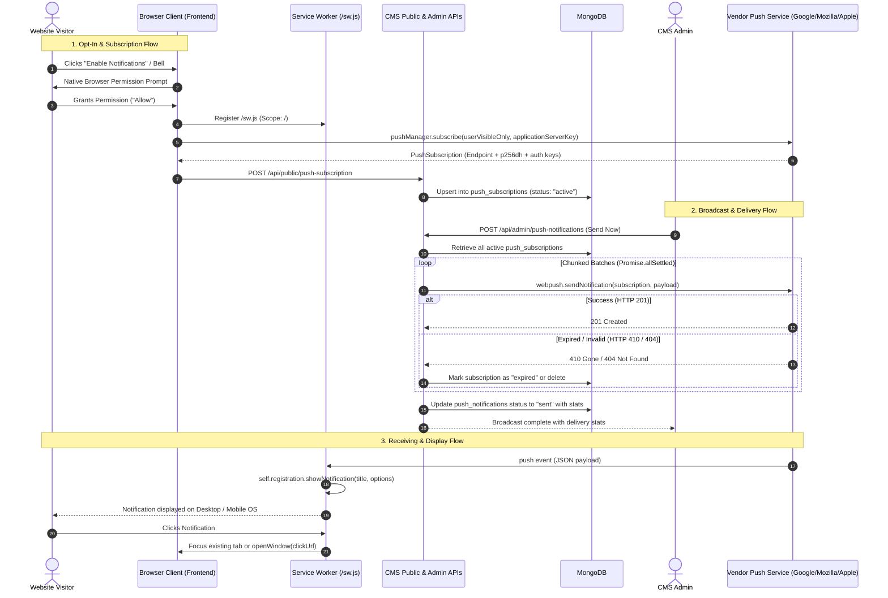
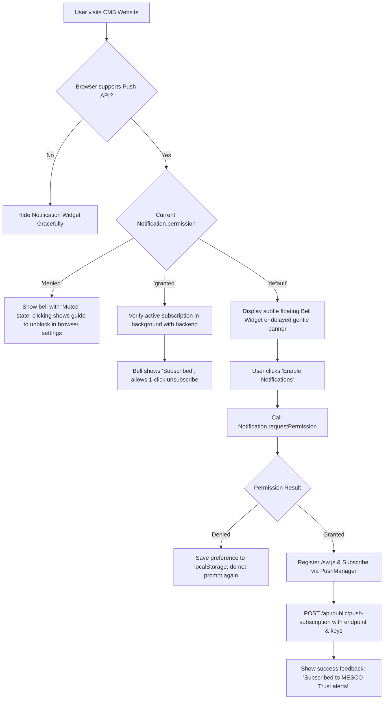

# Comprehensive Implementation Plan: Basic Browser Push Notifications for MESCO Trust CMS

**Document Status:** Complete Planning & Architecture Specification  
**Project:** MESCO Trust CMS (`mescotrust_cms`)  
**Target Milestone:** Native Browser Push Notifications (Events, Campaigns & Announcements)  
**Deliverable Type:** Architecture, Data Flow, Database Schemas, API Contracts, and Step-by-Step Plan  

---

## Executive Summary

This document outlines the detailed, production-grade technical implementation plan to introduce **Basic Browser Push Notifications** into the MESCO Trust CMS.

As outlined in the Business Requirement Document (BRD):
> **Requirement:** Browser push alerts for events, campaigns, and announcements, managed directly from the existing admin panel.

The plan strictly adheres to the existing architecture:
- Built natively using the **W3C Web Push API**, standard **VAPID (RFC 8292)** authentication, and a lightweight Node.js push utility (`web-push`).
- Zero reliance on expensive, third-party paid SaaS notification platforms (such as OneSignal, PushOwl, or WonderPush).
- Integrates seamlessly with the CMS's **Next.js 14 App Router**, **MongoDB/Mongoose** data models, **NextAuth + RBAC** permission system, and **Ant Design 5** admin layout.
- Protects all existing public pages, page builders, site components, and styling invariants.

---

## 1. Existing Project Architecture Analysis

A thorough audit of the `mescotrust_cms` codebase revealed the following architectural foundation:

| Layer | Current Implementation | Push Notification Fit |
|---|---|---|
| **Frontend Framework** | Next.js 14.2.18 (App Router), React 18.3.1, Ant Design 5.22, styled-components 6.1, Bootstrap 5.3.3 | Client-side push subscription widget mounts cleanly in `app/(site)/layout.js` without SSR flash. |
| **Backend & APIs** | Next.js App Router Route Handlers (`app/api/...`), Node.js runtime | Standard REST endpoints for public subscription registration and authenticated admin broadcasts. |
| **Authentication & RBAC** | NextAuth Credentials + JWT sessions, `lib/apiAuth.js`, `lib/rbac/catalog.js` | Granular permission model (`push_notifications.view`, `push_notifications.create`, `push_notifications.edit`, `push_notifications.delete`, `push_notifications.manage`) automatically enforced. |
| **Database & ODM** | MongoDB via Mongoose 8.8.0, connection pooling via `connectDB()` in `lib/db.js` | Fast indexed queries for active subscriptions and historical notification logs. |
| **Admin Navigation** | `components/admin/AdminLayoutClient.js` with responsive sidebar and permissions filtering | Adding `Push Notifications` into the sidebar under the engagement/communications group. |
| **Media Handling** | `components/admin/media/MediaPickerInput.js` | Existing media picker can be reused directly for optional notification banner images. |
| **CSRF & Security** | `middleware.js` verifies same-origin on state-changing API requests (`POST`, `PUT`, `DELETE`) | Client subscription requests originate from the same site and pass origin verification cleanly. |
| **Existing Notifications** | Currently only email notifications (`Subscriber.js`, `nodemailer`) and on-page announcements | Browser push is 100% new; zero collision with existing email or SMS systems. |

---

## 2. Recommended Technical Approach



### Why Native Web Push Over Third-Party Services?
1. **Zero External Subscriptions or Costs**: No recurring SaaS fees (e.g. OneSignal paid tiers, PushEngage, etc.).
2. **Complete Data Sovereignty & Privacy**: Visitor endpoints and encryption keys stay inside MESCO Trust's own MongoDB database.
3. **No Third-Party Tracker Bloat**: Keeps site performance fast, avoiding large third-party tracking scripts.
4. **Standard Compatibility**: Full support across modern Chrome, Edge, Firefox, Opera, and Safari (macOS 13+ and iOS 16.4+).

---

## 3. Proposed Admin Panel Navigation and UI Structure

### A. Sidebar Navigation
In `components/admin/AdminLayoutClient.js`, add a top-level menu item equipped with Ant Design's `<BellOutlined />`:

```javascript
{
  key: "/admin/push-notifications",
  icon: <BellOutlined />,
  label: (
    <Link href="/admin/push-notifications" style={linkStyle}>
      Push Notifications
    </Link>
  ),
}
```
*Placement:* Located right after **Popups** or within the engagement/submissions section for natural administrative workflow.

### B. Admin Page Layout (`/admin/push-notifications`)
The interface follows the exact design pattern of `PopupsModule.js` and `SubscribersPage`:
1. **Metric Overview Cards (Top Bar)**:
   - **Active Subscribers**: Real-time count of active browser endpoints.
   - **Total Notifications**: All-time broadcasts created.
   - **Successful Deliveries**: Total successful push deliveries.
   - **Delivery Rate %**: Percentage of successful push handoffs.
2. **Action & Filter Bar**:
   - Primary Action Button: `+ Create Notification` (opens create drawer).
   - Filter by Status: All / Draft / Sent / Failed.
   - Filter by Type: All / General Announcement / Event / Campaign.
   - Search input: Real-time search across title and message.
3. **Notifications Table (Ant Design Table)**:
   - **Notification**: Displays Title (bold), snippet of Message, and small image preview thumbnail if attached.
   - **Type**: Clean colored tag:
     - General Announcement (`blue`)
     - Event (`purple`)
     - Campaign (`green`)
   - **Status**:
     - `Draft`: `default` tag
     - `Sending`: `processing` tag with spinner
     - `Sent`: `success` tag
     - `Failed`: `error` tag
   - **Delivery Stats**:
     - Displays `Sent: X | Success: Y | Failed: Z` with tooltip breakdown.
   - **Sent / Created At**: Formatted via `formatDate(doc.sentAt || doc.createdAt)`.
   - **Created By**: Displays administrator email.
   - **Actions**:
     - For **Drafts**: `Send Now` (modal confirmation), `Edit` (opens drawer), `Delete` (popconfirm).
     - For **Sent/Failed**: `View Stats & Preview` (opens drawer/modal), `Clone as Draft`.

### C. Create / Edit Notification Drawer
A clean slide-out drawer (`PushNotificationDrawer.js`) containing:
- **Title** (Required, `Input`, max 100 characters with counter).
- **Message / Body** (Required, `Input.TextArea`, max 250 characters with counter).
- **Type** (Required, `Select`: "General Announcement", "Event", "Campaign").
- **Target Click URL** (Optional, `Input`, defaults to `/`). Supports relative paths (e.g., `/events/annual-meet-2026`) or full URLs.
- **Banner Image** (Optional, integrated with `MediaPickerInput` or direct URL).
- **Live Preview Card**: Renders a live preview mockup of how the push alert will appear on desktop and mobile operating systems.
- **Footer Actions**:
  - `Cancel`
  - `Save as Draft` (secondary button)
  - `Send Now` (primary danger/brand button with confirmation dialog)

---

## 4. Frontend Subscription Workflow

To ensure a non-intrusive and GDPR/privacy-friendly user experience:



### Key Frontend UX Principles:
1. **Zero Auto-Prompting**: Never call `Notification.requestPermission()` on initial page load. Browser vendors (Chrome, Safari, Firefox) penalize sites that auto-prompt without user engagement.
2. **Explicit Opt-in**: The prompt is triggered only when the user clicks the floating Notification Bell or an opt-in card.
3. **Respect User Dismissal**: If the user closes or dismisses the prompt, store `mesco_push_dismissed_until` in `localStorage` for 14 days.
4. **Graceful Fallback**: If the user is on an unsupported browser (or incognito mode with push disabled), the widget remains completely invisible.
5. **Footer Link Integration**: Provide a "Notification Preferences" action in the footer (mirroring the existing "Cookie Settings" pattern).

---

## 5. Admin Notification Creation and Sending Workflow

### Sending Mechanism & Concurrency Control
When an administrator clicks **Send Now**:
1. **State Lock**: The notification document status is immediately set to `"sending"` to prevent duplicate triggering from simultaneous clicks.
2. **Subscriber Retrieval**: Fetch all subscriptions with `{ status: "active" }` from MongoDB.
3. **Zero Subscriber Guard**: If 0 active subscriptions exist, mark status as `"sent"`, record note "No active subscribers", and return gracefully.
4. **Chunked Batch Processing**:
   - To prevent Node.js event-loop freezing, memory spikes, or socket exhaustion, send requests in concurrency batches of **30 subscriptions per batch**.
   - Use `Promise.allSettled()` for each batch.
5. **Handling Push Service Responses**:
   - **HTTP 201 Created**: Delivery handed off to vendor push service -> Increment `successfulSends`.
   - **HTTP 410 Gone / HTTP 404 Not Found**: Endpoint is expired or unsubscribed by user -> Automatically update subscription in DB to `{ status: "expired" }` and increment `expiredCleaned`.
   - **HTTP 429 / 5xx / Network Error**: Temporary vendor error -> Increment `failedSends`.
6. **Completion & Audit**:
   - Update `PushNotification` document:
     - `status`: `"sent"` (or `"failed"` if all attempts failed)
     - `sentAt`: `new Date()`
     - `stats`: `{ totalSubscribers, successfulSends, failedSends, expiredCleaned }`
   - Refresh the admin table to show the updated status tag and delivery breakdown.

---

## 6. Database Schema Planning

Two new Mongoose models will be created in `models/`.

### A. Model 1: `PushSubscription` (`models/PushSubscription.js`)
Stores browser push endpoints and ECDH encryption keys.

```javascript
const mongoose = require("mongoose");

const pushSubscriptionSchema = new mongoose.Schema(
  {
    endpoint: {
      type: String,
      required: true,
      unique: true,
      trim: true,
    },
    keys: {
      p256dh: { type: String, required: true, trim: true },
      auth: { type: String, required: true, trim: true },
    },
    status: {
      type: String,
      enum: ["active", "unsubscribed", "expired"],
      default: "active",
      index: true,
    },
    userAgent: { type: String, default: "", trim: true },
    deviceType: {
      type: String,
      enum: ["desktop", "mobile", "tablet", "unknown"],
      default: "unknown",
    },
    browser: { type: String, default: "" },
    userId: {
      type: mongoose.Schema.Types.ObjectId,
      ref: "User",
      default: null,
      nullable: true,
    },
    failureCount: { type: Number, default: 0 },
    lastDeliveredAt: { type: Date, default: null },
  },
  { timestamps: true, collection: "push_subscriptions" }
);

pushSubscriptionSchema.index({ endpoint: 1 }, { unique: true });
pushSubscriptionSchema.index({ status: 1, createdAt: -1 });
pushSubscriptionSchema.index({ userId: 1 });

module.exports =
  (mongoose.models && mongoose.models.PushSubscription) ||
  mongoose.model("PushSubscription", pushSubscriptionSchema);
```

### B. Model 2: `PushNotification` (`models/PushNotification.js`)
Stores notification history, content, draft state, and delivery statistics.

```javascript
const mongoose = require("mongoose");

const pushNotificationSchema = new mongoose.Schema(
  {
    title: {
      type: String,
      required: true,
      trim: true,
      maxlength: 120,
    },
    message: {
      type: String,
      required: true,
      trim: true,
      maxlength: 300,
    },
    imageUrl: {
      type: String,
      default: "",
      trim: true,
    },
    clickUrl: {
      type: String,
      default: "/",
      trim: true,
    },
    type: {
      type: String,
      enum: ["announcement", "event", "campaign"],
      default: "announcement",
      index: true,
    },
    status: {
      type: String,
      enum: ["draft", "sending", "sent", "failed"],
      default: "draft",
      index: true,
    },
    stats: {
      totalSubscribers: { type: Number, default: 0 },
      successfulSends: { type: Number, default: 0 },
      failedSends: { type: Number, default: 0 },
      expiredCleaned: { type: Number, default: 0 },
    },
    errorMessage: { type: String, default: "" },
    sentAt: { type: Date, default: null },
    createdBy: { type: String, default: "", trim: true },
    updatedBy: { type: String, default: "", trim: true },
  },
  { timestamps: true, collection: "push_notifications" }
);

pushNotificationSchema.index({ status: 1, createdAt: -1 });
pushNotificationSchema.index({ type: 1 });
pushNotificationSchema.index({ createdAt: -1 });

module.exports =
  (mongoose.models && mongoose.models.PushNotification) ||
  mongoose.model("PushNotification", pushNotificationSchema);
```

---

## 7. Backend API Endpoints

### A. Public Endpoints (Frontend Consumption)

| Method | Endpoint | Description | Authentication |
|---|---|---|---|
| `GET` | `/api/public/push-subscription/vapid-key` | Returns public VAPID key for frontend registration | Public |
| `POST` | `/api/public/push-subscription` | Register or reactivate a browser subscription | Public (same-origin check enforced) |
| `DELETE` | `/api/public/push-subscription` | Unsubscribe a browser endpoint | Public (same-origin check enforced) |

#### Contract: `POST /api/public/push-subscription`
- **Request Body**:
  ```json
  {
    "endpoint": "https://fcm.googleapis.com/fcm/send/...",
    "keys": {
      "p256dh": "BNcRdreALRF...",
      "auth": "tBHItDa..."
    },
    "userAgent": "Mozilla/5.0 ...",
    "deviceType": "desktop"
  }
  ```
- **Response**: `{ "success": true, "id": "67...abc" }`

---

### B. Admin Endpoints (Admin Panel Management)

All admin endpoints require valid NextAuth session and RBAC authorization (`push_notifications` module permissions).

| Method | Endpoint | Required Permission | Description |
|---|---|---|---|
| `GET` | `/api/admin/push-notifications` | `push_notifications.view` | Paginated listing with search and status/type filters |
| `POST` | `/api/admin/push-notifications` | `push_notifications.create` | Create a draft or send immediately |
| `GET` | `/api/admin/push-notifications/[id]` | `push_notifications.view` | Retrieve single notification details |
| `PUT` | `/api/admin/push-notifications/[id]` | `push_notifications.edit` | Update draft notification (drafts only) |
| `DELETE` | `/api/admin/push-notifications/[id]` | `push_notifications.delete` | Delete draft notification (drafts only) |
| `POST` | `/api/admin/push-notifications/[id]/send` | `push_notifications.manage` | Execute broadcast send on an existing draft |
| `GET` | `/api/admin/push-notifications/stats` | `push_notifications.view` | Aggregate stats (active subscribers, sent counts) |

---

## 8. Service Worker Implementation Requirements

### File Location: `public/sw.js`
In Next.js, static files in `/public` are served directly at the domain root (`/sw.js`). This grants the Service Worker full root scope (`/`), which is required to display notifications regardless of which page the user last visited.

### Core Handlers in `public/sw.js`:
```javascript
// 1. Immediate activation
self.addEventListener("install", (event) => {
  self.skipWaiting();
});

self.addEventListener("activate", (event) => {
  event.waitUntil(self.clients.claim());
});

// 2. Receive Push Event
self.addEventListener("push", (event) => {
  if (!event.data) return;

  let payload = {};
  try {
    payload = event.data.json();
  } catch (e) {
    payload = { title: "MESCO Trust Alert", message: event.data.text() };
  }

  const title = payload.title || "MESCO Trust";
  const options = {
    body: payload.message || "",
    icon: payload.icon || "/images/logo.svg",
    badge: payload.badge || "/images/logo.svg",
    image: payload.image || undefined,
    data: {
      url: payload.clickUrl || "/",
      notificationId: payload.notificationId || null,
    },
    vibrate: [100, 50, 100],
    tag: payload.notificationId ? `mesco-${payload.notificationId}` : "mesco-general",
    renotify: true,
  };

  event.waitUntil(self.registration.showNotification(title, options));
});

// 3. Notification Click Action
self.addEventListener("notificationclick", (event) => {
  event.notification.close();
  const targetUrl = event.notification.data?.url || "/";

  event.waitUntil(
    clients.matchAll({ type: "window", includeUncontrolled: true }).then((windowClients) => {
      // If a tab is already open on this site, navigate and focus it
      for (const client of windowClients) {
        if ("focus" in client) {
          if (client.url === targetUrl) {
            return client.focus();
          }
          if ("navigate" in client) {
            return client.navigate(targetUrl).then((c) => c?.focus());
          }
        }
      }
      // Otherwise open a new window/tab
      if (clients.openWindow) {
        return clients.openWindow(targetUrl);
      }
    })
  );
});
```

---

## 9. Required Packages and Dependencies

Only **one single production package** is required:

```bash
npm install web-push
```

### Dependency Evaluation:
- **Package**: `web-push` (v3.6.7 or latest compatible).
- **Size / Footprint**: Lightweight pure JavaScript library; wraps Node.js built-in `crypto` for elliptic curve p256 operations.
- **Compatibility**: 100% compatible with Node.js 18+ and Next.js 14 App Router API routes (`export const runtime = "nodejs"`).
- **Dev Dependencies**: No additional dev packages required.

---

## 10. Environment Variables and VAPID Configuration

### A. Required Keys in `.env`
```ini
# ─── Browser Push Notifications (Web Push VAPID) ────────────────────────────
# Generated via `npm run generate:vapid`
NEXT_PUBLIC_VAPID_PUBLIC_KEY=BExamplePublicKeyBase64URLString...
VAPID_PRIVATE_KEY=ExamplePrivateKeySecretString...
VAPID_SUBJECT=mailto:info@mescotrust.org
```

### B. Key Generation Helper Script
Add an operational script `scripts/generate-vapid-keys.js` and register `"generate:vapid": "node scripts/generate-vapid-keys.js"` in `package.json`. When executed, it outputs the generated public and private key pair formatted ready to paste into `.env`.

> [!IMPORTANT]
> **VAPID Key Persistence:** Once generated and deployed to production, VAPID keys must NEVER be regenerated or altered. Changing VAPID keys invalidates all previously saved browser subscriptions, requiring users to re-subscribe.

---

## 11. Security Considerations

1. **VAPID Private Key Protection**:
   - `VAPID_PRIVATE_KEY` has no `NEXT_PUBLIC_` prefix and is only imported inside server-side route handlers (`/api/admin/...`). It is never bundled into client JavaScript.
2. **Strict Admin Authentication & RBAC**:
   - Every admin route is validated with `requireAuth(req)` in `lib/apiAuth.js`.
   - Granular RBAC permissions ensure only authorized users can view, create, edit, or broadcast push alerts.
3. **Payload Sanitization & Constraints**:
   - Notification titles capped at 120 characters; messages capped at 300 characters.
   - Click URLs sanitized to prevent `javascript:` or unauthorized external phishing links.
4. **Endpoint Validation & CSRF Protection**:
   - `POST /api/public/push-subscription` validates that `endpoint` is a valid HTTPS URI matching standard push service hosts (e.g. `fcm.googleapis.com`, `push.services.mozilla.com`, `push.apple.com`).
   - Middleware same-origin check (`checkSameOrigin`) prevents cross-site request forgery.
5. **Rate Limiting**:
   - In-memory rate limiting on public subscription endpoints prevents automated subscriber flooding.

---

## 12. Error Handling and Expired Subscription Management

| Scenario | HTTP / Error Code | Handling Action |
|---|---|---|
| User revokes permission or uninstalls browser | `410 Gone` or `404 Not Found` | Catch specifically; update `PushSubscription.status = 'expired'` or delete from MongoDB. Increment `stats.expiredCleaned`. |
| Push vendor rate limit | `429 Too Many Requests` | Log warning; mark subscriber delivery as failed for this run without expiring the subscription. |
| Vendor push service temporary outage | `500` / `502` / `503` | Log error; keep subscription active for future broadcasts. |
| Incomplete / corrupt payload | `400 Bad Request` | Reject at API validation level before invoking push service. |
| Database network glitch during broadcast | Mongo timeout | Transaction/batch-safe updates ensure notification state reflects exact counts processed. |

---

## 13. List of Files to Create or Modify

### A. New Files to Create

| # | File Path | Type | Purpose & Details |
|---|---|---|---|
| 1 | `models/PushSubscription.js` | New Model | Mongoose schema for storing browser push endpoints, p256dh/auth keys, device info, and status (`active`, `unsubscribed`, `expired`). |
| 2 | `models/PushNotification.js` | New Model | Mongoose schema for notifications, draft status, message content, target link, type, and delivery metrics. |
| 3 | `lib/webPush.js` | New Utility | Server-side utility initializing `web-push`, formatting payloads, executing chunked batch sends, and pruning expired subscriptions. |
| 4 | `public/sw.js` | New Service Worker | Service Worker file listening for `push` events and handling `notificationclick` redirection. |
| 5 | `app/api/public/push-subscription/route.js` | New Route Handler | Public API to register and unsubscribe browser endpoints. |
| 6 | `app/api/public/push-subscription/vapid-key/route.js` | New Route Handler | Public endpoint exposing `NEXT_PUBLIC_VAPID_PUBLIC_KEY`. |
| 7 | `app/api/admin/push-notifications/route.js` | New Route Handler | Authenticated admin API to list and create notifications. |
| 8 | `app/api/admin/push-notifications/[id]/route.js` | New Route Handler | Authenticated admin API to get, update (draft), or delete (draft) a notification. |
| 9 | `app/api/admin/push-notifications/[id]/send/route.js` | New Route Handler | Authenticated admin API to execute broadcast delivery on a notification. |
| 10 | `app/api/admin/push-notifications/stats/route.js` | New Route Handler | Authenticated admin API returning subscriber counts and aggregate stats. |
| 11 | `components/admin/push-notifications/PushNotificationsModule.js` | New Component | Main admin UI module with stats cards, filter controls, and table container. |
| 12 | `components/admin/push-notifications/PushNotificationsTable.js` | New Component | Ant Design Table displaying notifications, badges, stats, and action menus. |
| 13 | `components/admin/push-notifications/PushNotificationDrawer.js` | New Component | Ant Design Drawer with form fields, live preview mockup, and draft/send actions. |
| 14 | `components/admin/push-notifications/PushNotificationDetailsModal.js` | New Component | Modal displaying detailed delivery statistics breakdown for sent notifications. |
| 15 | `components/site/PushNotification/PushNotificationWidget.js` | New Component | Client-side frontend bell widget with popover opt-in and permission sync. |
| 16 | `components/site/PushNotification/index.js` | New Component | Re-export entrypoint for the frontend widget. |
| 17 | `app/admin/(authenticated)/push-notifications/page.js` | New Route Page | Admin route entrypoint rendering `PushNotificationsModule`. |
| 18 | `scripts/generate-vapid-keys.js` | New Script | Operational script to generate new VAPID key pairs for `.env`. |

---

### B. Existing Files to Modify

| # | File Path | Modification Rationale | Required Changes |
|---|---|---|---|
| 1 | `lib/rbac/catalog.js` | Register new module in the RBAC engine | Add `{ key: "push_notifications", label: "Push Notifications", actions: CRUD_ACTIONS }` to `ADMIN_MODULES`; add alias `"push-notifications": "push_notifications"`; map menu key `"/admin/push-notifications": "push_notifications.view"`; add page permission resolver rule. |
| 2 | `components/admin/AdminLayoutClient.js` | Add module to admin sidebar | Import `BellOutlined` (already present) and add `{ key: "/admin/push-notifications", icon: <BellOutlined />, label: <Link href="/admin/push-notifications">Push Notifications</Link> }` into `baseMenuItems`. |
| 3 | `app/(site)/layout.js` | Inject frontend notification widget | Dynamically import `PushNotificationWidget` with `{ ssr: false }` and render it at the bottom alongside `CookieConsent`. |
| 4 | `next.config.js` | Ensure Service Worker is never cached | Add custom header rule for `/sw.js` with `Cache-Control: no-cache, no-store, must-revalidate` and `Service-Worker-Allowed: /`. |
| 5 | `package.json` | Register dependency and scripts | Add `"web-push": "^3.6.7"` to dependencies; add `"generate:vapid": "node scripts/generate-vapid-keys.js"` to scripts. |
| 6 | `.env.example` | Document environment variables | Add `NEXT_PUBLIC_VAPID_PUBLIC_KEY`, `VAPID_PRIVATE_KEY`, and `VAPID_SUBJECT` template entries. |
| 7 | `AGENTS.md` | Keep architectural documentation synchronized | Document the new models (`PushSubscription`, `PushNotification`) and admin route in the reference inventory. |

---

## 14. Step-by-Step Implementation Sequence

```mermaid
gantt
    title Push Notification Implementation Sequence
    dateFormat  X
    axisFormat %d

    section Phase 1: Setup & Data
    1. Dependencies & VAPID Generation       :active, p1, 0, 1
    2. Mongoose Models (Subscription/Notif)  :active, p2, 1, 2
    3. Backend WebPush Utility Library       :active, p3, 2, 3

    section Phase 2: RBAC & APIs
    4. RBAC Catalog & Permissions Update     :active, p4, 3, 4
    5. Public Subscription APIs              :active, p5, 4, 5
    6. Admin Notification CRUD & Send APIs   :active, p6, 5, 7

    section Phase 3: Service Worker & Client
    7. Service Worker (public/sw.js) & Config:active, p7, 7, 8
    8. Frontend Opt-In Widget & Layout Wire  :active, p8, 8, 10

    section Phase 4: Admin UI & Verification
    9. Admin Panel UI (Drawer, Table, Stats) :active, p9, 10, 12
    10. Sidebar Navigation Integration       :active, p10, 12, 13
    11. End-to-End Verification & Testing    :active, p11, 13, 14
```



### Detailed Execution Steps:
1. **Phase 1: Dependencies & Data Layer**:
   - Install `web-push`.
   - Create `scripts/generate-vapid-keys.js` and run it to populate `.env`.
   - Create `models/PushSubscription.js` and `models/PushNotification.js`.
   - Create `lib/webPush.js` (core broadcast and cleanup helper).
2. **Phase 2: Authorization & APIs**:
   - Update `lib/rbac/catalog.js` with `push_notifications` module definitions.
   - Implement `app/api/public/push-subscription/route.js` and `vapid-key/route.js`.
   - Implement `app/api/admin/push-notifications/route.js`, `[id]/route.js`, and `[id]/send/route.js`.
3. **Phase 3: Service Worker & Frontend Experience**:
   - Create `public/sw.js` with `push` and `notificationclick` listeners.
   - Update `next.config.js` with caching headers for `/sw.js`.
   - Create `components/site/PushNotification/PushNotificationWidget.js`.
   - Mount in `app/(site)/layout.js`.
4. **Phase 4: Admin Panel UI**:
   - Build `PushNotificationsTable.js`, `PushNotificationDrawer.js`, and `PushNotificationsModule.js`.
   - Create `app/admin/(authenticated)/push-notifications/page.js`.
   - Add entry to `components/admin/AdminLayoutClient.js`.
5. **Phase 5: Verification & Hardening**:
   - Run linter (`npm run lint`).
   - Execute local subscription, draft save, and broadcast tests.

---

## 15. Testing Strategy

### A. Local Development Testing
- **Localhost Privilege**: Modern browsers treat `http://localhost:3000` as a secure origin, allowing full Service Worker and Web Push testing without SSL certificates.
- **Test Scenarios**:
  1. *Opt-in Flow*: Open incognito window, visit `http://localhost:3000`, click Notification Bell, click "Allow". Check MongoDB to verify active document in `push_subscriptions`.
  2. *Duplicate Guard*: Refresh page and re-subscribe; confirm no duplicate record created in `push_subscriptions`.
  3. *Unsubscribe Flow*: Click bell again to toggle off; confirm subscription status switches to `"unsubscribed"`.
  4. *Admin Draft*: In admin panel, create a notification as "Draft". Verify it appears in table with `Draft` tag. Edit fields, verify update.
  5. *Live Broadcast*: Click "Send Now". Observe OS notification popup on desktop. Check delivery statistics in table (1 sent, 1 success, 0 failed).
  6. *Notification Click*: Click OS notification; verify that browser switches to and focuses the configured URL.
  7. *Dead Endpoint Pruning*: Manually alter endpoint in database or revoke permissions in browser, then send a notification. Verify that response status 410/404 is caught and the subscription is marked `"expired"`.
  8. *RBAC Testing*: Log in as Editor role vs Admin role; verify permission enforcement on create and send actions.

### B. Production Testing
- Test over live HTTPS with real device endpoints (Chrome on Windows/macOS, Firefox on Linux/macOS, Safari on macOS, Chrome on Android).
- Validate that background push wakes up inactive browser tabs.

---

## 16. Deployment Requirements & HTTPS Configuration

1. **Mandatory HTTPS**:
   - In production environments, browsers strictly require HTTPS for Service Workers and Push notifications.
2. **Reverse Proxy & Header Forwarding**:
   - In Nginx / Apache / Cloudflare reverse proxies, ensure standard headers are forwarded:
     ```nginx
     proxy_set_header X-Forwarded-Proto $scheme;
     proxy_set_header Host $host;
     ```
3. **CDN Caching Exclusion**:
   - If Cloudflare or a CDN cache is enabled, add a Page Rule / Cache Rule ensuring `/sw.js` is set to **Bypass Cache**.
4. **Environment Variables**:
   - Ensure `NEXT_PUBLIC_VAPID_PUBLIC_KEY`, `VAPID_PRIVATE_KEY`, and `VAPID_SUBJECT` are defined in production hosting environment variables (e.g. PM2, Docker, or Vercel/AWS).

---

## 17. Potential Technical Limitations and Risks

1. **iOS Safari Constraints**:
   - On iOS (iPhones/iPads), Apple only supports the Web Push API starting with **iOS 16.4+**, and exclusively when the user has added the website to their Home Screen ("Add to Home Screen" / PWA mode). On standard mobile Safari tabs, `window.PushManager` is undefined. The frontend widget detects this and gracefully remains hidden without throwing errors.
2. **User Notification Fatigue**:
   - Repeated or aggressive push prompts lead visitors to permanently block notifications in browser settings. The design prevents this by keeping opt-in completely explicit and voluntary.
3. **VAPID Key Invalidation Risk**:
   - If production `VAPID_PRIVATE_KEY` is accidentally replaced or lost, existing browser subscriptions will fail with 401 Unauthorized and cannot be recovered without users re-subscribing. The plan includes backup instructions and documentation in `AGENTS.md`.
4. **Browser Battery Savers & Do Not Disturb**:
   - Desktop and mobile OS-level "Do Not Disturb" or "Focus" modes may suppress or delay alert banners until the user exits focus mode. This is standard OS behavior outside application control.

---

## Conclusion & Readiness

This plan delivers a complete, lightweight, robust, and native Browser Push Notification system tailored specifically to the `mescotrust_cms` codebase. It requires no heavy architectural rework, preserves all existing site components, and provides a polished, intuitive administrative management experience.

**Awaiting approval from the user before proceeding to implementation.**
